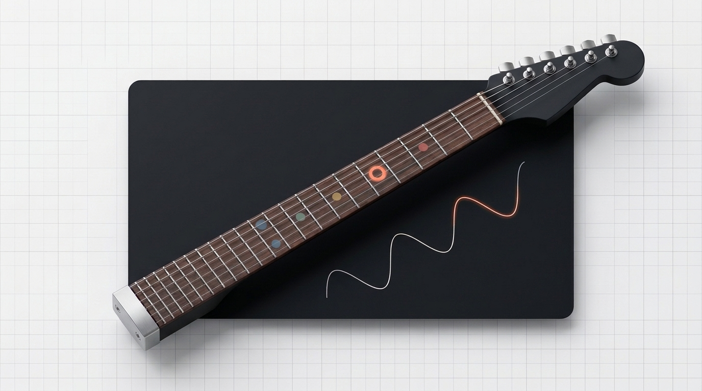
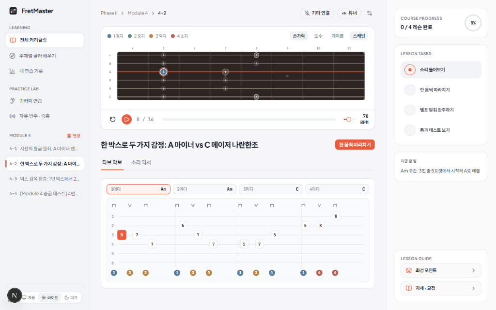
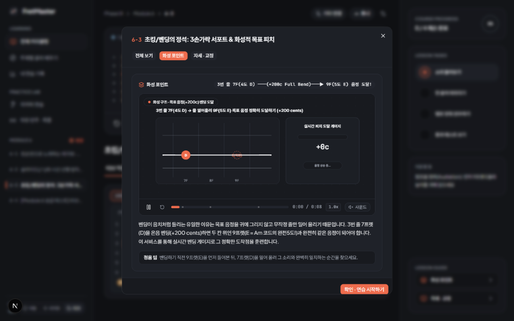

<p align="center">
  
</p>

<h1 align="center">FretMaster Studio</h1>

<p align="center">
  Web Audio <code>AudioWorklet</code> 기반 단음·코드 실시간 판정, 지판 중심 화성 커리큘럼, Remotion 운지·자세 가이드를 결합한 오픈소스 일렉트릭 기타 연습 스튜디오입니다.
</p>

<p align="center">
  <a href="https://github.com/srain0626/fretmaster-studio/actions/workflows/ci.yml"></a>
  <a href="ROADMAP.md"></a>
  <a href="LICENSE"></a>
  <a href="README.md"></a>
</p>

<p align="center">
  <a href="https://fretmasterstudio.seltum.xyz"><strong>라이브 앱</strong></a> &middot;
  <a href="#오디오-수집-및-dsp-아키텍처">오디오 &amp; DSP</a> &middot;
  <a href="#판정-엔진과-연습-모드">판정 &amp; 연습 모드</a> &middot;
  <a href="#커리큘럼과-모션-가이드">커리큘럼</a> &middot;
  <a href="#로컬-실행-및-환경-설정">로컬 실행</a> &middot;
  <a href="#디렉터리-구조-및-내부-문서">프로젝트 구조</a> &middot;
  <a href="ROADMAP.md">로드맵</a> &middot;
  <a href="CONTRIBUTING.md">기여 안내</a>
</p>

---

## 프로젝트 개요

웹에서 동작하는 기존 기타 연습 도구들은 대체로 두 가지 한계를 가집니다. 리듬 게임처럼 타브(TAB) 숫자만 흘려보내 왜 해당 프렛이 배경 코드 위에서 어울리는지 설명하지 못하거나, 메인 스레드 기반의 단순 피치 검출기를 사용해 저음현에서 옥타브가 튀고 2~3줄 코드 스트로크를 제대로 판별하지 못합니다.

**FretMaster Studio**는 실제 일렉트릭 기타의 음향 특성과 독학 입문자의 학습 흐름에 맞춰 설계한 영·한 이중언어 연습 환경(GPL-3.0)입니다.

- **오디오 전용 스레드 기반 단음·다성 코드 판정**: 128샘플 단위로 동작하는 `AudioWorkletProcessor` 안에서 `4096`-샘플 YIN 단음 추적(`65~1450 Hz`, 서브하모닉 옥타브 오류 억제)과 `8192`-포인트 Hann Radix-2 FFT 다성 코드 스펙트럼 분석(`MIDI 40..84`)을 힙 할당 없이 동시 처리합니다.
- **오선지 암기 대신 지판 기하학으로 배우는 화성**: 4개 Phase, 9개 모듈, 39개 레슨 전반에 걸쳐 `+1프렛 = 반음`, `3G -> 2B` 장3도 튜닝 이동, 디스토션에서 파워코드가 3도를 생략하는 이유, 같은 펜타토닉 박스에서 루트만 바꿔 나란한조(`Am` / `C`)를 오가는 원리, 코드 체인지 시 3도·7도 타겟팅을 손가락 간격으로 직접 익힙니다.
- **사운드와 프레임 단위로 맞물리는 Remotion 모션 가이드**: 모든 레슨마다 화성 구조 애니메이션(11종)과 피킹 각도·프렛 단면·서포트 벤딩 등 생체역학 자세 애니메이션(8종)을 `720x320 @ 30fps` 사양으로 제공하며, Web Audio 기타 신스 사운드와 동기화됩니다.
- **시각 피로를 줄인 절제된 스튜디오 UI**: 네온 발광 효과나 불필요한 장식을 배제하고, Light/Dark 테마 시맨틱 CSS 변수와 4손가락 저채도 어스 팔레트만으로 현재 짚어야 할 운지와 뮤트 상태, 박자 오차에 시선이 모이도록 구성했습니다.

| Light 테마 &middot; 3단 스튜디오 워크스페이스 (`4-2` 나란한조) | Dark 테마 &middot; Remotion 모션 가이드 (`6-3` 벤딩) |
| :---: | :---: |
|  |  |
| <sub>22프렛 SVG 지판, 4손가락 컬러 매핑, 마디별 코드 및 TAB 타임라인 동기화</sub> | <sub><code>720x320</code> Remotion 컴포지션, <code>+200c</code> 목표 피치 게이지 및 신스 사운드 연동</sub> |

---

## 오디오 수집 및 DSP 아키텍처

### 실시간 입력 파이프라인과 신호 처리

일렉트릭 기타 신호는 브라우저에서 다루기 까다로운 물리적 특성을 보입니다. 권선현인 6번 줄(`E2 = 82.41 Hz`)과 5번 줄(`A2 = 110.00 Hz`)은 기본파보다 2배음·3배음 에너지가 강하게 잡혀 한 옥타브 위로 오판하기 쉽고, 피킹 직후 `100~160 ms` 구간에는 어택 노이즈가 섞이며, 2채널 오디오 인터페이스의 단일 Hi-Z 입력을 스테레오 평균(`Mono`)으로 그대로 합산하면 신호가 `-6 dB` 감쇠합니다.

`public/worklets/guitarPitchWorklet.js`와 `src/lib/lowLatencyAudioEngine.ts`는 세 가지 입력 경로와 다단 필터링으로 이 문제를 처리합니다.

```text
기타 -> Hi-Z 오디오 인터페이스 / USB 기타 케이블 / 마이크
  |
  +-- [1] 기본 경로: AudioWorkletNode ('guitar-pitch-processor', 128-sample quantum)
  |     |-- 채널 및 게인  : ch1 | ch2 | mono 선택, 소프트웨어 입력 트림(-18..+18 dB), 원음 클리핑 감지(>= -0.5 dBFS)
  |     |-- 링 버퍼       : 4096 샘플, 256 샘플 홉(~5.33 ms @ 48 kHz), 노이즈 게이트(기본값 -58 dBFS)
  |     |-- 전처리 필터   : DC 오프셋 제거 + ~1400 Hz 1차 저역통과 필터(LPF)
  |     |-- 온셋 검출기   : RMS 급증비(> 1.45x) + 고역 트랜지언트 변화량(55 ms 쿨다운) + 레가토 피치 변화 온셋
  |     |-- 단음 YIN 추적 : CMNDF(65~1450 Hz, 임계값 0.18, 폴백 < 0.34) + 2*tau 서브하모닉 검사 + 포물선 보간
  |     +-- 다성 FFT 분석 : 무할당(Zero-GC) 8192-pt Hann Radix-2 FFT -> 45-bin noteSpectrum(MIDI 40..84) & 12-bin chroma
  |
  +-- [2] 폴백 경로: AnalyserNode (fftSize 4096 + requestAnimationFrame)
  |     +-- 브라우저 정책 등으로 AudioWorklet 로드가 실패할 때 동일한 YIN + 다성 FFT 연산으로 자동 전환
  |
  +-- [3] 하드웨어 브리지: 로컬 WebSocket ('ws://127.0.0.1:9420')
        +-- 네이티브 ASIO / CoreAudio 데몬 패킷 수신 (1.5초 내 응답이 없으면 AudioWorklet으로 자동 폴백)
              |
              v
      guitarAudioEngine (5프레임 중앙값 스무딩, 160 ms 어택 안정화 온셋 이월, 레이턴시 오프셋 보정)
              |
              +--> resolveFretPositionForContext()  [동일 MIDI 음정의 22프렛 다중 유니즌 위치 판별]
              +--> evaluateNoteHit()                [단음 피치·박자 오차·벤딩 도달률 및 다성 코드 판정]
              +--> updateAdaptiveLatencyProfile()   [마디 단위 누적 타이밍 편차 자동 보정]
```

#### 다성 코드 스트로크 및 개방현 뮤트 검증

두 줄 이상을 동시에 치는 파워코드와 트라이어드 구간에서는 단음 YIN만으로는 정확한 채점이 불가능합니다. 워크릿 생성 시점에 미리 할당해 둔 고정 길이 배열(`Float32Array` 실수/허수 버퍼, Hann 윈도우, `Uint16Array` 비트 반전 테이블) 위에서 가비지 컬렉션 없이 `8192`-포인트 제로패딩 FFT(`48 kHz` 기준 빈 해상도 약 `5.86 Hz`)를 함께 수행합니다.

`src/lib/lowLatencyAudioEngine.ts`의 `evaluatePolyphonicChord()`는 45개 반음 에너지 스펙트럼(`E2`~`C6`)과 12빈 크로마 벡터를 대조해 다음 세 가지를 판별합니다.

1. 파워코드(`1+5`, `1+5+8`), 3음 쉘 보이싱(`R-3-7`), 오픈/이동형 트라이어드 구성음이 동시에 울리고 있는지 확인합니다.
2. 메이저 코드에서 단3도를 짚거나 마이너 코드에서 장3도를 짚는 3도 오운지(`wrongThirdDetected`)를 잡아냅니다.
3. 5번 줄 루트 코드(`A5`, `C` 등) 연주 중 뮤트하지 않은 6번 개방현(`E2`)이 함께 울리는 저음 블리드(`unmutedStringWarning`)를 감지해 안내합니다.

#### 로컬 ASIO / CoreAudio WebSocket 프로토콜 (`ws://127.0.0.1:9420`)

Windows ASIO, macOS CoreAudio, Linux JACK 환경에서 네이티브 드라이버 버퍼(`2~4 ms` 왕복 지연)를 직접 연결할 수 있도록 로컬호스트 WebSocket 규격이 열려 있습니다. 소켓 연결 직후 클라이언트는 아래 설정 패킷을 전송합니다.

```json
{
  "type": "config",
  "channelMode": "ch1",
  "noiseGateDb": -58
}
```

로컬 브리지 데몬은 분석 프레임을 아래 JSON 형식으로 스트리밍하면 스튜디오 판정 엔진과 그대로 연동됩니다.

```json
{
  "frequency": 220.0,
  "rmsDb": -24.5,
  "peakDb": -12.1,
  "isClipping": false,
  "isOnset": true,
  "clarity": 0.94,
  "chroma": [0.02, 0.01, 0.04, 0.02, 0.41, 0.03, 0.01, 0.02, 0.01, 0.88, 0.02, 0.01],
  "noteSpectrum": [0.0, "... MIDI 40(E2)~84(C6)에 대응하는 45개 정규화 에너지 배열"]
}
```

### 레이턴시 보정 및 Web Audio 기타 신스 트랜스포트

직결 오디오 인터페이스(`~6~12 ms`)와 노트북 내장 스피커·마이크 조합(`~35~90 ms`)은 입출력 지연 편차가 크기 때문에, `AudioInterfaceModal`에서 두 가지 측정 방식과 실시간 드리프트 보정을 함께 제공합니다.

- **1클릭 음향 루프백 핑**: `1800 Hz` 펄스 4회(`playCalibrationPing`)를 출력한 뒤 입력 파이프라인으로 되돌아오는 실제 왕복 시간을 측정해 `-50 ms ~ +200 ms` 범위에서 즉시 보정값을 산출합니다.
- **60fps 시각적 6탭 캘리브레이터**: 밀폐형 헤드폰을 착용해 스피커 루프백 측정이 어려운 환경에서 시각 비트와 타건 타이밍으로 오프셋을 맞춥니다.
- **마디별 적응형 보정(`AdaptiveLatencyProfile`)**: 연주 도중 마디 단위로 일관되게 누적되는 미세 지연 편차를 추적해 실제 박자 실수를 가리지 않는 선에서 오프셋을 다듬습니다.

가이드 기타와 반주 트랙은 `ElectricGuitarSynthEngine`(`src/lib/guitarSynthEngine.ts`)이 실시간 합성합니다. `AudioContext.currentTime`에 맞물린 `25 ms` 룩어헤드 스케줄러(`setInterval`)와 오디오 컨텍스트 일시정지 시의 하이브리드 월클록 폴백을 갖추고 있으며, 진공관 포화 커브(`WaveShaperNode`) 기반 앰프 프리셋 3종(`clean`, `crunch`, `lead`)과 `4200 Hz`(`Q = 0.8`) 캐비닛 필터 위에서 14가지 아티큘레이션(`normal`, `hammer`, `pull`, `slide-up`, `slide-down`, `bend-half`, `bend-full`, `bend-15`, `prebend-release`, `vibrato`, `palm-mute`, `double-stop`, `chord`, `tap`)을 구현합니다.

---

## 판정 엔진과 연습 모드

### 4단계 점진적 판정 기준 (`JUDGMENT_TIERS`)

처음 운지를 익힐 때와 박자·벤딩 정밀도를 다듬을 때 요구되는 허용 오차가 다르므로 4단계 판정 티어를 선택할 수 있습니다. 순차 해금 모드에서는 **Standard** 이상으로 시험(`exam`)을 통과하면 다음 레슨이 열립니다.

| 티어 | 용도 | Perfect | Good | Pass | 피치 허용폭 | 벤딩 도달률 | 통과 기준점 |
| :--- | :--- | :---: | :---: | :---: | :---: | :---: | :---: |
| **Relaxed** | 입문 운지 적응 | `&plusmn;110 ms` | `&plusmn;220 ms` | `&plusmn;300 ms` | `&plusmn;55 cents` | `65%` | `70` |
| **Standard** | 정규 승급 기준 | `&plusmn;65 ms` | `&plusmn;130 ms` | `&plusmn;180 ms` | `&plusmn;42 cents` | `80%` | `80` |
| **Tight** | 칼박 및 피치 교정 | `&plusmn;35 ms` | `&plusmn;75 ms` | `&plusmn;110 ms` | `&plusmn;28 cents` | `90%` | `85` |
| **Studio Master** | 무힌트 블라인드 시험 | `&plusmn;18 ms` | `&plusmn;40 ms` | `&plusmn;65 ms` | `&plusmn;18 cents` | `94%` | `90` |

**Studio Master** 단계로 시험 모드를 실행하면 `ElectricFretboard`에서 스케일 배경 도트, 현재 타겟 프렛 하이라이트, 다음 음 고스트 프리뷰가 모두 숨겨져 청음과 손끝 감각만으로 완주해야 합니다.

### 문맥 기반 유니즌(동일 음정 다중 포지션) 판별

22프렛 표준 튜닝 기타에서는 동일한 MIDI 음정이 최대 5곳의 줄·프렛 조합에 동시에 존재합니다(예: `E4`(`MIDI 64`)는 `1번 줄 0F`, `2번 줄 5F`, `3번 줄 9F`, `4번 줄 14F`, `5번 줄 19F`). `src/lib/musicTheory.ts`의 `resolveFretPositionForContext()`는 현재 목표 `NoteEvent`, 활성 스케일 박스, 레슨의 `focusFretRange`, 개방현 인체공학을 우선순위로 비교해 지판 위 실시간 피드백이 엉뚱한 줄로 튀지 않도록 고정합니다.

### 6가지 연습 모드

| 모드 | 코드값 | 트랜스포트 동작 | 판정 및 화면 동작 |
| :--- | :---: | :--- | :--- |
| **가이드 청취** | `guide` | 가이드 기타 ON, Phase II 이상 드럼/베이스/코드 ON | 패시브 피치 텔레메트리 표시, 목표 프레이즈와 리듬 확인 |
| **한 음씩 대기** | `wait` | 목표 음을 정확히 칠 때까지 플레이헤드 일시 대기 | 템포 압박 없이 운지 위치와 코드 울림을 한 음씩 검증 |
| **구간 루프** | `loop` | 지정 마디 반복 재생 + 완료 시 `+5 BPM` 자동 가속 옵션 | 까다로운 1~2마디 셀 집중 반복 및 실시간 타격 피드백 |
| **마스터리 시험** | `exam` | 예비박 카운트인 후 가이드 기타 OFF, 메트로놈 ON | 전 구간 완주 채점 -> `MasteryReportDialog` 리포트 및 세션 기록 |
| **블라인드 귀카피** | `earcopy` | 타브 프렛 숫자를 가린 채 데모 프레이즈 재생 | Module 9(`9-1`, `9-2`): 3단계 힌트 제공, 청음 매칭 시 숨겨진 TAB 해금 |
| **자유 즉흥 잼** | `jam` | 드럼·베이스·코드 백킹 ON, 가이드 기타 OFF | Module 9(`9-3`, `9-4`): 스케일 적합도, 코드 톤 착지, 프레이징 여백, 표현력 실시간 평가 및 허밍-투-프렛보드 매퍼 |

---

## 커리큘럼과 모션 가이드

### 5단계 지판 화성 구조

음악 이론을 별도 암기 과목으로 분리하지 않고, 지판 위 물리적 거리와 도형으로 단계별 확장합니다.

1. **Layer 1 &middot; 프렛 간격과 튜닝 기하학 (`Module 1~2`)**: `+1프렛 = 반음`, `+2프렛 = 온음`, 개방현 완전4도 간격과 `3G -> 2B` 구간만 장3도여서 모든 도형이 브리지 쪽으로 1프렛 밀리는 원리, L자 옥타브 도형을 익힙니다.
2. **Layer 2 &middot; 파워코드와 장·단 3화음 (`Module 3`)**: 드라이브 톤에서 배음 혼탁을 막기 위해 3도를 빼는 파워코드(`1+5+8`), 브리지 새들 위 오른손 팜뮤트 위치, 3도 음 하나만 반음(`M3 <-> b3`) 옮겨 메이저와 마이너 성격을 바꾸는 원리를 다룹니다.
3. **Layer 3 &middot; 펜타토닉 골격과 나란한조 (`Module 4`)**: `A` 마이너 펜타토닉 1번 박스(`R-b3-4-5-b7`)를 익힌 뒤, 똑같은 `5~8F` 운지 박스에서 착지 루트만 `A`에서 `C`로 바꾸면 `C` 메이저 펜타토닉이 되는 나란한조 관계와 포지션 대각선 슬라이드를 연결합니다.
4. **Layer 4 &middot; 7음 스케일 확장과 3NPS (`Module 5~7`)**: 새 스케일 표를 통째로 외우는 대신 익숙한 펜타토닉 5음 빈칸에 컬러 노트 2음(`2도·b6도`, `b5` 블루 노트, `#7` 하모닉 마이너)만 채워 넣는 방식과 줄당 3음(`3NPS`) 대칭 구조를 연습합니다.
5. **Layer 5 &middot; 보이스 리딩과 코드 톤 타겟팅 (`Module 6~9`)**: 코드가 바뀔 때 배경 코드의 3도·7도로 착지하는 프레이징, 3손가락 서포트 기반 `+100c / +200c` 정밀 벤딩, 5대 장르 컴핑(블루스 셔플, 믹솔리디안 록, 펑크 트라이어드 인버전, 메탈 페달 포인트, `R-3-7` 쉘 보이싱), 단계별 솔로 에튀드, 블라인드 귀카피 및 즉흥 연주로 이어집니다.

### Remotion 화성·생체역학 모션 가이드

레슨에 진입하거나 우측 하단 `LESSON GUIDE` 카드를 누르면 `LessonGuideDialog`가 열리며, 두 개의 `@remotion/player` 컴포지션(`720x320`, `30fps`, 240프레임 루프, `0.75x / 1.0x` 배속 전환, 타임라인 스크러빙, Web Audio 사운드 큐 연동)을 제공합니다.

- **화성 포인트 컴포지션 11종** (`HarmonyExplainerComposition.tsx`): `open-strings`, `octave-geometry`, `interval-steps`, `triad-morph`, `progression-arc`, `powerchord-wave`, `relative-flip`, `pentatonic-box`, `scale-color-fill`, `bend-pitch-lock`, `chord-tone-lead`
- **자세·교정 생체역학 컴포지션 8종** (`PostureExplainerComposition.tsx`): `pick-pendulum`(`35~40도` 피크 엣지 각도), `fretwire-cross-section`(프렛쇠 `2 mm` 뒤 수직 가압 단면), `palm-mute-bridge`, `chord-touch-mute`(검지 안쪽 줄 뮤트), `legato-eye-shift`, `bend-pivot`(엄지 넥 상단 고정 및 손목 회전축), `ear-comp-jam`, `anchor-spider-grip`

### 전체 커리큘럼 목차 (4 Phases &middot; 9 Modules &middot; 39 Lessons)

첫 레슨인 `1-1`(`m1-1`)은 개방현 잔향 판정으로 입문자가 첫 단계에서 막히지 않도록 `skipExam: true` 워밍업 레슨으로 구성되어 가이드·대기·루프 실습 후 바로 `1-2`로 넘어갑니다. 좌측 커리큘럼 브라우저에서 **자유 탐색(Free Explore)** 스위치를 켜면 잠금 순서와 무관하게 원하는 레슨으로 바로 이동할 수 있습니다.

<details>
<summary><strong>전체 39개 레슨 상세 목차 펼쳐보기 (<code>1-1</code> ~ <code>9-4</code>)</strong></summary>

<br />

- **Phase I &middot; 입문 물리 기초와 4손가락 독립**
  - **Module 1: 첫 줄 울리기와 손 모양 기초**
    - `1-1` 개방현 6형제와 다운/업 피킹 진자 운동 *(워밍업, `skipExam`)*
    - `1-2` 버징 없는 첫 프렛 짚기: 검지·중지·약지와 반음/온음
    - `1-3` 앵커 핑거(Anchor Finger) 법칙과 1-2-3 워킹
    - `1-4` [승급 테스트] 3손가락으로 연주하는 첫 단선율 록 리프
  - **Module 2: 크로매틱 &amp; 4손가락 독립**
    - `2-1` 소지(4번 손가락) 깨우기: 1-2-3-4 크로매틱 스파이더
    - `2-2` 약지·소지 신경 분리: 1-3-2-4 &amp; 1-4-2-3 순열 에튀드
    - `2-3` 줄 이동(String Crossing)과 인사이드/아웃사이드 피킹
    - `2-4` [승급 테스트] 스트링 스키핑 &amp; 지판 옥타브 도형 찾기
- **Phase II &middot; 리듬 코드, 펜타토닉과 7음 풀 스케일**
  - **Module 3: 파워코드, 트라이어드 &amp; 리듬 뮤트**
    - `3-1` 파워코드(1-3-4 운지)와 검지 줄 뮤트
    - `3-2` 오른손 팜뮤트(Palm Mute)와 8비트 다이나믹 악센트
    - `3-3` 장3화음 vs 단3화음 트라이어드
    - `3-4` [승급 테스트] `I - V - vi - IV` 실전 록/팝 백킹 리듬
  - **Module 4: 펜타토닉 스케일 &amp; 나란한조**
    - `4-1` A 마이너 펜타토닉 1번 박스 (`R-b3-4-5-b7`)
    - `4-2` 한 박스로 두 가지 감정: A 마이너 vs C 메이저 나란한조
    - `4-3` 1번 박스에서 2번 박스로 대각선 슬라이드 런
    - `4-4` [승급 테스트] 4연음 계단식 시퀀스 &amp; 검지 롤링
  - **Module 5: 7음 풀 스케일 &amp; 코드 톤 타겟팅**
    - `5-1` 펜타토닉 + 2음 = 7음 A 내추럴 마이너 스케일
    - `5-2` 블루 노트(`b5`)와 크로매틱 해결
    - `5-3` 3-Notes-Per-String (`3NPS`) 대칭 구조
    - `5-4` [승급 테스트] 코드 체인지 시 코드 톤 착지하기
- **Phase III &middot; 표현 기법, 장르 컴핑과 솔로 에튀드**
  - **Module 6: 일렉기타 핵심 표현 테크닉**
    - `6-1` 해머링 온(`H`) &amp; 풀오프(`P`) 레가토
    - `6-2` 슬라이드(`/`, `\`)와 시선 선행(Eye-Lead Shifting)
    - `6-3` 3손가락 서포트 벤딩 &amp; 목표 피치(`+200c`)
    - `6-4` [승급 테스트] 비브라토, 유니즌 벤딩 &amp; 더블 스탑 꾸밈음
  - **Module 7: 5대 장르 실전 화성 &amp; 반주·리프**
    - `7-1` [Blues] 12마디 블루스(`I7 - IV7 - V7`) 셔플 반주와 문답법
    - `7-2` [Classic &amp; Hard Rock] 개방현 파워코드와 `I - bVII - IV` 믹솔리디안 리프
    - `7-3` [Pop &amp; Funk] 고음부 트라이어드 자리바꿈(Voice Leading) 반주
    - `7-4` [Metal &amp; Neoclassical] 페달 포인트와 하모닉 마이너(`#7`)
    - `7-5` [승급 테스트 &middot; Neo-Soul &amp; Jazz] 3음 쉘 보이싱(`R-3-7`)과 도리안(`#6`)
  - **Module 8: 솔로 단계별 해부 (Lv.1~6 오리지널 교육 에튀드)**
    - `8-1` [Lv.1] 멜로딕 록 발라드 프레이징 (*Knockin' on Heaven's Door* 스타일)
    - `8-2` [Lv.2] 그런지 보컬 멜로디 라인 (*Smells Like Teen Spirit* 스타일)
    - `8-3` [Lv.3] 스위트 박스 블루스 (*The Thrill Is Gone* 스타일)
    - `8-4` [Lv.4] 코드 톤 롱 서스테인 벤딩 (*Comfortably Numb* 스타일)
    - `8-5` [Lv.5] 아르페지오 &amp; 하모닉 마이너 턴 (*Sweet Child O' Mine* 스타일)
    - `8-6` [승급 테스트 &middot; Lv.6] 펜타토닉 클라이맥스 루프 &amp; 5음 캐스케이드 (*Page / Johnson* 스타일)
- **Phase IV &middot; 블라인드 귀카피, 반주와 즉흥 연주**
  - **Module 9: 귀카피, 자유 반주 &amp; 즉흥 스튜디오**
    - `9-1` [귀카피 데크 1] 펜타토닉 1번 박스 안에서 귀로 듣고 채보하기
    - `9-2` [귀카피 데크 2] 베이스 루트 음으로 코드 진행 알아맞히기
    - `9-3` [자유 반주 스튜디오] 드럼·베이스 위 트라이어드 반주 &amp; 더블스탑 필인
    - `9-4` [마스터 랩] 반주/솔로 롤 스위칭 즉흥 연주 &amp; 허밍-투-프렛보드 매퍼

</details>

---

## 웹 스택과 데이터 동기화

| 계층 | 사용 기술 | 비고 |
| :--- | :--- | :--- |
| **프레임워크** | Next.js `16.4.6` (App Router, Turbopack), React `19.3`, TypeScript `5` | 레거시 `middleware.ts` 대신 Next.js 16 규격인 `src/proxy.ts` 사용 (`cacheComponents`, `partialPrefetching`) |
| **스타일링 &amp; UI** | Tailwind CSS `4.3`, `shadcn/ui` (`@base-ui/react` `1.9`), `@heroui/react` `3.2` | Light/Dark 시맨틱 CSS 변수(`var(--*)`), 초기 테마 깜빡임(FOUC) 방지 인라인 부트 스크립트 |
| **모션 &amp; 그래픽** | Remotion `4.0.545` (`@remotion/player`), Framer Motion `14.14`, `lucide-react` | 커스텀 모노라인 기타 SVG(`GuitarSvgIcons.tsx`), `reduced-motion` 대응 스프링 |
| **인증 &amp; 데이터베이스** | Supabase (`@supabase/ssr`, PostgreSQL + Row-Level Security) | PKCE Google OAuth(`/auth/callback`), 충돌 없는 진도 병합, `/admin` RBAC 통계 콘솔 |
| **테스트 &amp; CI** | Node 내장 테스트 러너 (`node --test`), GitHub Actions (`Node 22`) | YIN 피치, 8192-pt 코드 FFT, 트랜스포트 타이밍, 어드민 권한 및 이모지 0건 검증 자동화 |

### 라우트 구조 및 진도 병합 모델

- **`/` (`src/app/page.tsx`)**: 공개 이중언어 랜딩 페이지입니다. 지판 화성 데모와 실시간 코칭 프리뷰를 바로 실행할 수 있고, `?lesson=<id>` 딥링크가 OAuth 로그인 이후에도 그대로 유지됩니다. 데이터베이스 환경 변수 없이도 즉시 동작합니다.
- **`/studio` (`src/app/studio/page.tsx`)**: 로그인 사용자 전용 3단 스튜디오 워크스페이스(`232px` 커리큘럼 사이드바 / 중앙 가변폭 SVG 지판 + `tab`/`lab` 덱 / `284px` 연습 제어 패널)입니다.
- **`/admin` (`src/app/admin/page.tsx`)**: 서버 측 `is_admin_user()` 검증과 PostgreSQL RLS로 보호되는 퍼널 및 테이블 통계 대시보드입니다.
- **무손실 로컬·클라우드 병합 (`src/lib/progressSync.ts`)**: 스튜디오 진입 시 브라우저의 `localStorage['fretmaster_studio_progress_v1']`와 Supabase `public.user_progress` 레코드를 단조 증가 규칙(`completed = local || cloud`, 점수·최고 BPM·스트릭·역량 지표 `Math.max`, 최고 달성 `JudgmentTier` 보존)으로 병합한 뒤, 이후 변경분은 `800 ms` 디바운스로 저장하고 시험 완료 이력은 `public.practice_sessions`에 추가 기록합니다.

---

## 로컬 실행 및 환경 설정

### 사전 요구 사항

- **Node.js** `20` 이상 (GitHub Actions CI는 `Node.js 22` 기준)
- **브라우저**: `AudioWorklet` 및 오디오 입력 권한을 지원하는 최신 Chrome, Edge, Firefox, Safari (`http://localhost:3000` 또는 HTTPS 환경)
- **기타 입력 장비**: Hi-Z 악기 입력을 지원하는 USB 오디오 인터페이스(권장), USB 기타 케이블, 또는 마이크

### 1. 설치 및 개발 서버 구동

```powershell
git clone https://github.com/srain0626/fretmaster-studio.git
cd fretmaster-studio
npm install
npm run dev
```

브라우저에서 `http://localhost:3000`을 엽니다.

- **`.env.local` 미설정 시**: 공개 랜딩 페이지(`/`)와 인터랙티브 지판·사운드 데모는 별도 설정 없이 바로 확인할 수 있습니다. 다만 `/studio` 경로는 현재 Supabase 로그인 세션을 요구하므로 환경 변수가 없으면 설정 안내 카드(`AuthGateCard`)가 표시됩니다(비로그인 1레슨 즉시 체험 샌드박스는 `v0.4.0` 반영 예정).
- **`.env.local` 설정 시**: 아래 절차에 따라 Supabase를 연결하면 Google 로그인, `/studio` 전체 기능, 클라우드 진도 동기화가 활성화됩니다.

### 2. Supabase 및 환경 변수 설정

루트의 `.env.example`을 `.env.local`로 복사해 값을 채웁니다.

```powershell
Copy-Item .env.example .env.local
```

```dotenv
# /studio Google 로그인 및 진도 동기화 필수 항목
NEXT_PUBLIC_SUPABASE_URL=https://your-project-id.supabase.co
NEXT_PUBLIC_SUPABASE_ANON_KEY=your-anon-public-key

# 선택 항목: GTM 태그 및 /admin 접근 허용 이메일(쉼표 구분)
NEXT_PUBLIC_GTM_ID=GTM-XXXXXXXX
ADMIN_EMAILS=you@example.com
```

1. **Supabase Dashboard -> SQL Editor**에서 [`supabase/schema.sql`](supabase/schema.sql) 전체를 실행합니다(`profiles`, `user_progress`, `practice_sessions`, `analytics_events` 테이블, `auth.uid()` 기반 RLS 정책, 신규 가입 시 행을 자동 생성하는 `handle_new_user()` 트리거가 생성됩니다).
2. **Authentication -> Providers**에서 **Google**을 활성화하고 Google Cloud OAuth 클라이언트 ID·Secret을 등록합니다.
3. **Authentication -> URL Configuration**의 **Redirect URLs**에 `http://localhost:3000/auth/callback`(및 배포 도메인의 `/auth/callback`)을 추가합니다.

### 3. 오디오 인터페이스 연결 팁

스튜디오 상단 텔레메트리 바의 오디오 장치 버튼을 누르면 **Audio Setup** 모달이 열립니다.

- **입력 채널 고정**: Scarlett 2i2, Audient iD4, Volt 2 등 2채널 인터페이스의 Input 1 또는 Input 2 한쪽에만 기타를 꽂은 경우 `Mono` 대신 해당 채널(`Ch 1` 또는 `Ch 2`)을 직접 지정해야 `-6 dB` 평균 감쇠 없이 깨끗한 신호 대 잡음비를 얻을 수 있습니다.
- **입력 게인 확보**: 강한 코드 스트로크 시 피크 미터가 `-12 dBFS ~ -3 dBFS` 사이에서 움직이고 `-0.5 dBFS` 클리핑 경고가 뜨지 않도록 인터페이스 하드웨어 게인 또는 소프트웨어 트림(`-18..+18 dB`)을 조절합니다.
- **레이턴시 보정**: 스피커·오픈형 모니터링 환경에서는 **1클릭 음향 핑**, 밀폐형 헤드폰 환경에서는 **시각적 6탭 보정**을 최초 1회 실행해 두는 것을 권장합니다.

### 4. 테스트 및 빌드 검증

Windows PowerShell 5.1 환경에서는 명령어 연결 시 `&&` 대신 `;`를 사용합니다.

```powershell
# DSP(YIN 피치, 8192-pt 코드 FFT), 트랜스포트 스케줄러, 어드민 권한 유닛 테스트
npm test

# src/, public/worklets/, tests/, scripts/ 내 유니코드 이모지·딩뱃 0건 검증
npm run check:emojis

# ESLint 및 Next.js 프로덕션 빌드·타입 검사
npm run lint
npm run build
```

---

## 디렉터리 구조 및 내부 문서

```text
fretmaster-studio/
├── .github/workflows/ci.yml          # Node 22 CI: npm test -> check:emojis -> next build
├── AGENTS.md                         # Next.js 16 규칙 및 모듈형 기술 문서 라우터
├── CONTRIBUTING.md                   # 기여 절차, UI/코드 불변 규칙 및 레슨 작성 가이드
├── ROADMAP.md                        # v0.3.1 베이스라인 ~ v1.0.0 마일스톤 상세 계획
├── docs/                             # 서브시스템별 요약 기술 명세 (01..07)
├── public/worklets/
│   └── guitarPitchWorklet.js         # 무할당 128-sample AudioWorklet (YIN + 8192-pt FFT)
├── scripts/
│   └── check-emojis.mjs              # 유니코드 이모지 및 딩뱃 문자 혼입 차단 스크립트
├── supabase/
│   └── schema.sql                    # PostgreSQL 스키마, 가입 트리거 및 RLS 정책
├── tests/                            # Node 유닛 테스트 (dsp, polyphonic, transport, admin)
└── src/
    ├── proxy.ts                      # Next.js 16 SSR 인증 쿠키 갱신 프록시
    ├── types/guitar.ts               # 도메인 모델, Lesson/NoteEvent 및 텔레메트리 타입
    ├── data/
    │   ├── modulesMeta.ts            # 9개 모듈 메타데이터
    │   ├── curriculumHelpers.ts      # buildNotes(), makeChordBar(), 스케일 오버레이 팩토리
    │   ├── lessonsPhase1.ts..4.ts    # 39개 레슨 데이터 정의 (m1-1 .. m9-4)
    │   ├── curriculumEn.ts           # 영문 모듈·레슨 번역 매핑 테이블
    │   ├── coachingNotesEn.ts        # 노트별 영문 코칭 메시지 매핑 (230+ 항목)
    │   └── curriculumData.ts         # ALL_LESSONS 통합 배열 및 런타임 다국어 변환 헬퍼
    ├── lib/
    │   ├── lowLatencyAudioEngine.ts  # Worklet/Analyser/ASIO 수집 및 단음·코드 판정기
    │   ├── guitarSynthEngine.ts      # 진공관 포화 커브 기타 신스 및 25ms 트랜스포트
    │   ├── musicTheory.ts            # 주파수/MIDI 변환, 유니즌 포지션 판별, 4손가락 팔레트
    │   ├── progressSync.ts           # localStorage <-> Supabase PostgreSQL 병합 동기화
    │   ├── i18n.tsx                  # EN/KO LocaleProvider 및 브라우저 언어 감지
    │   ├── theme.ts                  # Light/Dark/System 테마 상태 훅
    │   ├── auth.tsx & adminAuth.ts   # Supabase OAuth 클라이언트 및 서버 어드민 RBAC
    │   └── analytics.ts              # 자체 /api/telemetry 수집 및 GTM dataLayer 연동
    ├── app/
    │   ├── page.tsx                  # 공개 이중언어 랜딩 페이지 (/)
    │   ├── studio/page.tsx           # 3단 연습 스튜디오 워크스페이스 (/studio)
    │   ├── admin/page.tsx            # 어드민 퍼널·테이블 분석 콘솔 (/admin)
    │   ├── auth/callback/route.ts    # PKCE OAuth 콜백 라우트
    │   └── api/                      # /api/telemetry, /api/admin/me, /api/admin/stats
    └── components/
        ├── landing/                  # 랜딩 인터랙티브 지판 및 코칭 프리뷰 컴포넌트
        ├── studio/                   # FretMasterStudioClient, 온보딩 및 오류 진단 모달
        ├── fretboard/                # ElectricFretboard (22F SVG) 및 TabTimeline
        ├── animations/               # ExplainerVideoShell, 화성·자세 Remotion 컴포지션
        ├── audio/                    # 실시간 피치 바, 크로매틱 튜너, AudioInterfaceModal
        ├── curriculum/               # 사이드바, 커리큘럼 탐색 모달, SkillAnalyticsDialog
        └── practice/                 # LessonGuideDialog 및 MasteryReportDialog
```

### 서브시스템별 내부 기술 문서 (`docs/`)

수천 줄짜리 데이터 파일이나 메인 클라이언트를 통째로 읽지 않고도 각 도메인의 설계 계약과 주의사항을 바로 파악할 수 있도록 [`docs/INDEX.md`](docs/INDEX.md) 아래에 7개 기술 문서를 분리해 두었습니다.

| 문서 경로 | 수록 범위 |
| :--- | :--- |
| [`docs/01-ARCHITECTURE.md`](docs/01-ARCHITECTURE.md) | 부트 초기화, `localStorage` 키 규격, 3단 스튜디오 그리드, 6가지 연습 모드 상태 흐름 |
| [`docs/02-UI-SYSTEM.md`](docs/02-UI-SYSTEM.md) | Light/Dark CSS 토큰, 4손가락 컬러 코드, HeroUI v3와 Base UI(`shadcn`) CSS 충돌 주의사항 |
| [`docs/03-CURRICULUM.md`](docs/03-CURRICULUM.md) | 39개 레슨 ID, `buildNotes` 팩토리 사용법, 순차 해금 및 `skipExam` 동작 규칙 |
| [`docs/04-AUDIO-DSP.md`](docs/04-AUDIO-DSP.md) | `AudioWorklet` YIN/FFT 세부 파라미터, ASIO WebSocket 패킷 규격, `JUDGMENT_TIERS` |
| [`docs/05-ANIMATIONS.md`](docs/05-ANIMATIONS.md) | Remotion 플레이어 `resetKey` 안정성 규칙, 화성 11종·자세 8종 매핑, `720x320` 안전 영역 |
| [`docs/06-MAINTENANCE-RUNBOOK.md`](docs/06-MAINTENANCE-RUNBOOK.md) | CLI 검증 명령어, 자주 겪는 CSS/TS/오디오 함정과 해결책, 브라우저 QA 체크리스트 |
| [`docs/07-AUTH-AND-DATABASE.md`](docs/07-AUTH-AND-DATABASE.md) | 공개/보호 라우트, `src/proxy.ts`, Supabase 스키마·RLS 정책, 진도 병합 흐름 |

---

## 로드맵

현재 프로덕션 베이스라인은 **`v0.3.1`**이며, 마일스톤별 세부 범위와 연결 이슈는 **[ROADMAP.md](ROADMAP.md)**에서 관리합니다.

| 마일스톤 | 상태 | 핵심 구현 항목 |
| :--- | :---: | :--- |
| **`v0.1` – `v0.2.6`** | 완료 | 영·한 39레슨 커리큘럼, 4096-샘플 YIN `AudioWorklet`, 문맥 기반 유니즌 지판 매핑, 시험 예비박 카운트인, Peak/Clip 게인 미터, 시각·적응형 레이턴시 보정, Supabase 동기화 |
| **`v0.3.0` – `v0.3.1`** | **현재** | `8192`-pt FFT 다성 코드 스트로크 판정(`#4`), Node CI 유닛 테스트 및 1클릭 음향 루프백 핑(`#2`), 학습자 중심 `/` 랜딩 및 `?lesson=` 딥링크, `1-1` 무시험 워밍업 진행, `/admin` 분석 콘솔 |
| **`v0.4.0`** | 예정 | 주간 연습 히스토리 차트 및 취약 마디 드릴 큐(`#5`), 무로그인 1레슨 게스트 샌드박스, `Drop D` / `Eb Standard` / `Open G` 변칙 튜닝 및 가상 카포(`#3`), 단음 뮤트·비브라토 파형 코칭 |
| **`v0.5.0`** | 계획 | 오픈소스 Rust(`cpal`) 네이티브 ASIO / CoreAudio WebSocket 데몬(`:9420`, `#1`), Web Audio 컨볼루션 캐비닛 IR 및 다이렉트 모니터링, 벨로시티 레이어 샘플 백킹 |
| **`v0.6.0`** | 계획 | Module 10 바레코드(`F` / `Bm` E·A폼) 생체역학 가이드 및 CAGED 연결, Funk / City-Pop / J-Rock / K-Indie 에튀드 팩, Jam Lab 12키 조바꿈 |
| **`v1.0.0`** | 계획 | 커스텀 TAB·백킹 루프 에디터 및 MusicXML 입출력(`#6`), 커뮤니티 레슨 팩 PR 검증 CLI, 태블릿 가로 레이아웃 및 오프라인 우선 PWA |

---

## 기여 안내

오디오 인터페이스 환경별 판정 리포트, DSP 파라미터 개선, 신규 Remotion 생체역학 씬 추가, 영·한 레슨 에튀드 기여를 기다립니다. 작업 전 **[CONTRIBUTING.md](CONTRIBUTING.md)**와 [`docs/INDEX.md`](docs/INDEX.md)의 해당 도메인 문서를 먼저 확인해 주세요.

코드 리뷰와 CI에서 공통으로 확인하는 저장소 규칙은 다음과 같습니다.

1. **시맨틱 CSS 변수 기반 Light/Dark 동시 대응**: 컴포넌트 스타일뿐 아니라 인라인 SVG 내부 stroke/fill에도 하드코딩 색상 대신 `var(--background)`, `var(--card)`, `var(--foreground)`, `var(--primary)` 변수를 사용합니다.
2. **이모지·딩뱃·네온 효과 금지**: `npm run check:emojis`가 유니코드 이모지와 딩뱃(`U+2600..U+27BF`)을 검사합니다. 아이콘은 `lucide-react` 또는 모노라인 SVG `<path>`만 사용합니다.
3. **영·한 번역 동기화**: UI 문구는 `useLocale()`(`tr(en, ko)`)로 작성하고, 커리큘럼·코칭 데이터 추가 시 `src/data/curriculumEn.ts`와 `src/data/coachingNotesEn.ts`를 함께 갱신합니다.
4. **제출 전 로컬 검증 통과**: PR 생성 전에 `npm test`, `npm run check:emojis`, `npm run lint`, `npm run build` 네 가지 검사가 모두 통과하는지 확인합니다.

---

## 저작권 및 라이선스

### 1. 소스 코드 (`GNU GPL-3.0`)

Copyright (C) 2026 Ray Kim. 본 저장소의 소스 코드는 **[GNU General Public License v3.0](LICENSE)** 조건에 따라 배포됩니다. 누구나 자유롭게 실행, 연구, 수정 및 재배포할 수 있으며, 수정본이나 파생 저작물을 외부에 배포하거나 네트워크 서비스로 공개할 경우 동일한 GPL-3.0 라이선스 아래 전체 소스 코드를 함께 공개해야 합니다.

### 2. 오리지널 교육용 에튀드 안내

**Module 7(장르 화성·리프)** 및 **Module 8(솔로 단계별 해부 `8-1` ~ `8-6`)**에 수록된 모든 악보 데이터, 코드 진행, Web Audio 합성 사운드는 특정 화성 기법과 주법을 학습하기 위해 직접 작성한 오리지널 교육용 에튀드입니다. 상업용 마스터 음원, 백킹 트랙, 유료 악보나 타브 사본을 복제하거나 재배포하지 않으며, 본문에 언급된 아티스트명과 곡명은 연주 스타일을 설명하기 위한 참조 표기로서 각 권리자에게 귀속됩니다.

### 3. 서드파티 오픈소스 라이선스

| 패키지 / 자산 | 라이선스 |
| :--- | :--- |
| `next`, `react`, `tailwindcss`, `framer-motion`, `@base-ui/react`, `@supabase/supabase-js` | `MIT` |
| `@heroui/react`, `@heroui/styles` | `Apache-2.0` |
| `lucide-react` | `ISC` |
| `Pretendard`, `Plus Jakarta Sans`, `JetBrains Mono` | `SIL OFL 1.1` |
| `remotion`, `@remotion/player` | [Remotion License](https://github.com/remotion-dev/remotion/blob/main/LICENSE.md) *(개인, 비영리 단체, 임직원 3인 이하 기업 무료)* |
