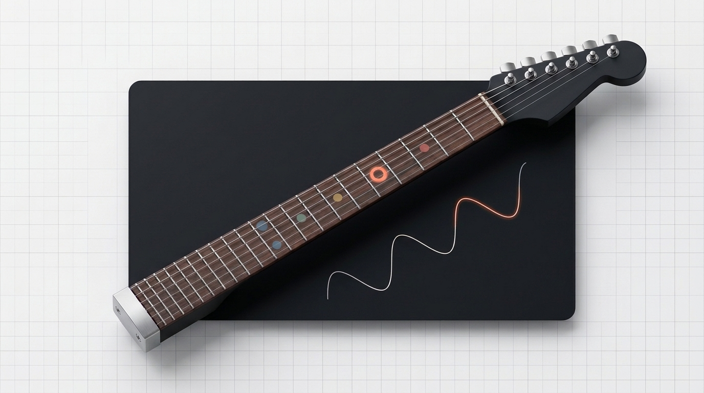
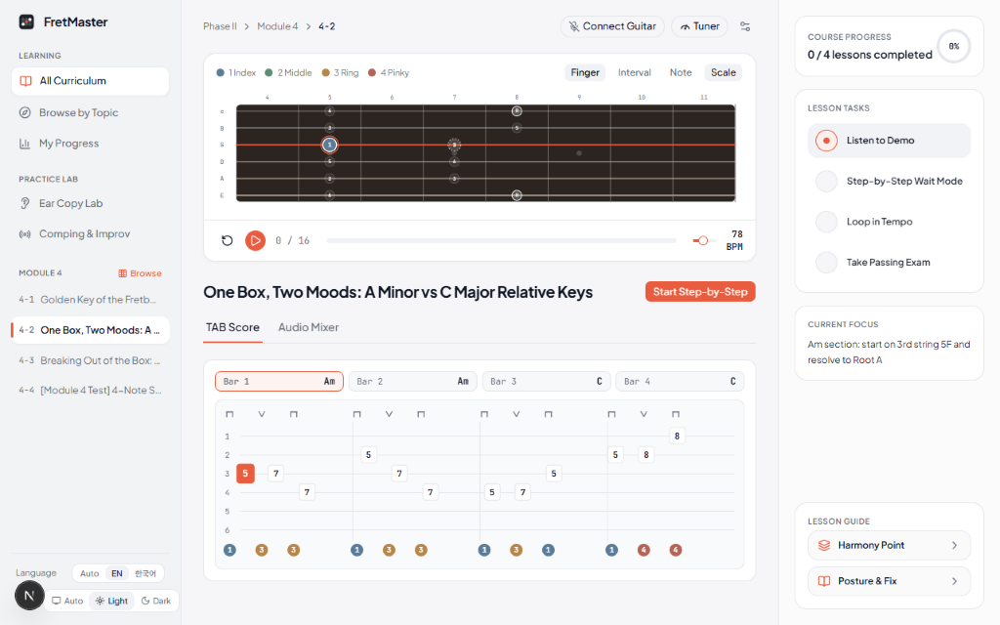

<p align="center">
  
</p>

<h1 align="center">FretMaster Studio</h1>

<p align="center">
  Interactive electric guitar practice studio built on Web Audio <code>AudioWorklet</code> DSP, fretboard-first harmony, and frame-synced Remotion technique guides.
</p>

<p align="center">
  <a href="https://github.com/srain0626/fretmaster-studio/actions/workflows/ci.yml"></a>
  <a href="ROADMAP.md"></a>
  <a href="LICENSE"></a>
  <a href="README.ko.md"></a>
</p>

<p align="center">
  <a href="https://fretmasterstudio.seltum.xyz"><strong>Live App</strong></a> &middot;
  <a href="#architecture--audio-pipeline">Audio &amp; DSP</a> &middot;
  <a href="#judgment-engine--practice-modes">Grading &amp; Modes</a> &middot;
  <a href="#curriculum--motion-guides">Curriculum</a> &middot;
  <a href="#getting-started">Getting Started</a> &middot;
  <a href="#project-layout--internal-docs">Project Layout</a> &middot;
  <a href="ROADMAP.md">Roadmap</a> &middot;
  <a href="CONTRIBUTING.md">Contributing</a>
</p>

---

## Overview

Most browser-based guitar tools fall into one of two traps: either they scroll TAB numbers like an arcade rhythm game without explaining why a note works over the chord underneath, or they rely on naive main-thread pitch trackers that jump an octave on low strings and choke on two- or three-note chord strums.

**FretMaster Studio** is an open-source (GPL-3.0) bilingual (`EN` / `KO`) practice environment designed around how electric guitar is physically played and heard:

- **Off-main-thread pitch and chord analysis**: Runs a zero-allocation 128-sample `AudioWorkletProcessor` combining `4096`-sample YIN monophonic tracking (`65–1450 Hz` with subharmonic octave-error rejection) and an `8192`-point Hann Radix-2 FFT for polyphonic power-chord and triad verification (`MIDI 40..84`).
- **Fretboard geometry instead of staff-paper memorization**: Across 4 phases, 9 modules, and 39 lessons, intervals are taught directly as finger distances on a 22-fret neck (`+1F` half step, `3G -> 2B` major-third tuning shift, `1+5` power chords, relative minor/major root flips inside the same pentatonic box, and chord-tone resolution).
- **Synchronized biomechanical and harmonic animations**: Every lesson pairs interactive Remotion SVG compositions (`720x320 @ 30fps`) for left/right-hand mechanics and harmonic structure with frame-accurate Web Audio guitar synth playback.
- **Restrained studio interface**: Built with Light and Dark theme parity, muted 4-finger earth color coding, zero neon glows, and zero decorative clutter so visual attention stays on finger placement, string muting, and timing.

| Light Theme &middot; 3-Column Studio (`4-2` Relative Keys) | Dark Theme &middot; Remotion Motion Guide (`6-3` Bends) |
| :---: | :---: |
|  |  |
| <sub>22-fret SVG neck, muted 4-finger palette, synced chord &amp; TAB timeline</sub> | <sub><code>720x320</code> Remotion composition with <code>+200c</code> bend gauge and synth cue sync</sub> |

---

## Architecture & Audio Pipeline

### Real-Time Capture & DSP Signal Chain

Electric guitar signals present specific edge cases in the browser: wound low strings (`6E = 82.41 Hz`, `5A = 110.00 Hz`) often produce stronger 2nd and 3rd harmonics than fundamentals, pick attacks introduce broadband noise during the first `100–160 ms`, and 2-channel USB audio interfaces drop `-6 dB` if a single Hi-Z input is blindly summed to stereo-mono.

`public/worklets/guitarPitchWorklet.js` and `src/lib/lowLatencyAudioEngine.ts` handle these constraints across three selectable input pipelines:

```text
Guitar -> Hi-Z Audio Interface / USB Cable / Microphone
  |
  +-- [1] Primary: AudioWorkletNode ('guitar-pitch-processor', 128-sample quantum)
  |     |-- Routing & Gain : ch1 | ch2 | mono, software trim (-18..+18 dB), raw clip flag (>= -0.5 dBFS)
  |     |-- Ring Buffer    : 4096 samples, 256-sample hop (~5.33 ms @ 48 kHz), noise gate (default -58 dBFS)
  |     |-- Pre-Filter     : DC offset removal + 1-pole ~1400 Hz low-pass filter
  |     |-- Onset Detector : RMS jump (> 1.45x) + HF transient delta (55 ms cooldown) + legato pitch-shift trigger
  |     |-- Monophonic YIN : CMNDF (65-1450 Hz, threshold 0.18, fallback < 0.34) + 2*tau subharmonic guard + parabolic interp
  |     +-- Polyphonic FFT : Zero-GC 8192-pt Hann Radix-2 FFT -> 45-bin noteSpectrum (MIDI 40..84, f1 + 2*f1) & 12-bin chroma
  |
  +-- [2] Fallback: AnalyserNode (fftSize 4096 + requestAnimationFrame)
  |     +-- Activates automatically if AudioWorklet initialization is blocked; runs matching YIN + polyphonic math
  |
  +-- [3] Hardware Bridge: Local WebSocket ('ws://127.0.0.1:9420')
        +-- Streams native ASIO / CoreAudio frames; falls back to AudioWorklet after 1.5s if no daemon responds
              |
              v
      guitarAudioEngine (5-frame median smoothing, 160 ms attack-settling carryover, latency offset compensation)
              |
              +--> resolveFretPositionForContext()  [disambiguates identical MIDI pitches across 22 frets]
              +--> evaluateNoteHit()                [mono pitch, timing window, peak bend ratio, or polyphonic chord]
              +--> updateAdaptiveLatencyProfile()   [progressive per-bar drift adjustment]
```

#### Polyphonic Chord & String-Bleed Verification

Monophonic pitch trackers collapse when strumming two or three strings at once. Alongside YIN, the worklet computes an `8192`-point zero-padded FFT (`~5.86 Hz` bin resolution at `48 kHz`) using preallocated typed arrays (`Float32Array` real/imaginary buffers, Hann window, and `Uint16Array` bit-reversal lookup tables) so garbage collection never stalls the audio thread.

`evaluatePolyphonicChord()` in `src/lib/lowLatencyAudioEngine.ts` inspects the 45-bin `noteSpectrum` (`E2` through `C6`) and 12-bin `chroma` vector to:

1. Confirm simultaneous energy across required chord tones for power chords (`1+5`, `1+5+8`), shell voicings (`R-3-7`), and open/movable triads.
2. Catch Major vs. Minor 3rd fretting mistakes (`wrongThirdDetected`) when a learner plays a natural 3rd over a minor chord or vice versa.
3. Detect unmuted open bass strings (`unmutedStringWarning`), such as an open `6E` ringing underneath a 5th-string root `A5` or `C` chord.

#### Local ASIO / CoreAudio WebSocket Protocol (`ws://127.0.0.1:9420`)

For players on Windows ASIO, macOS CoreAudio, or Linux JACK who want native hardware buffer sizes (`2–4 ms` round-trip), `lowLatencyAudioEngine.ts` exposes a documented localhost WebSocket transport. Upon connection, the browser sends a configuration frame:

```json
{
  "type": "config",
  "channelMode": "ch1",
  "noiseGateDb": -58
}
```

The local daemon streams JSON analysis frames back to the studio:

```json
{
  "frequency": 220.0,
  "rmsDb": -24.5,
  "peakDb": -12.1,
  "isClipping": false,
  "isOnset": true,
  "clarity": 0.94,
  "chroma": [0.02, 0.01, 0.04, 0.02, 0.41, 0.03, 0.01, 0.02, 0.01, 0.88, 0.02, 0.01],
  "noteSpectrum": [0.0, "... 45 normalized bins covering MIDI 40 (E2) to MIDI 84 (C6)"]
}
```

### Latency Calibration & Web Audio Synth Transport

Input-to-judgment latency varies substantially between a direct USB audio interface (`~6–12 ms`) and laptop speakers feeding into a built-in mic (`~35–90 ms`). `AudioInterfaceModal` provides two calibration workflows plus runtime drift tracking:

- **1-Click Acoustic Loopback Ping**: Emits four `1800 Hz` pulses (`playCalibrationPing`) and measures exact acoustic round-trip arrival through the active input pipeline (`-50 ms` to `+200 ms` clamp).
- **60fps Visual 6-Tap Runway**: Measures human/audio sync against a visual beat bar when using closed-back headphones where acoustic loopback is isolated.
- **Per-Bar Adaptive Offset (`AdaptiveLatencyProfile`)**: Tracks systematic early/late hit bias across bars and nudges compensation without masking genuine rhythmic errors.

Backing tracks and reference guitar tones are generated in real time by `ElectricGuitarSynthEngine` (`src/lib/guitarSynthEngine.ts`), driven by a `25 ms` lookahead scheduler (`setInterval`) locked to `AudioContext.currentTime` (with a hybrid wall-clock fallback when browser autoplay policy holds the context suspended). Guitar voices pass dual oscillators through tube-saturation `WaveShaperNode` curves (`clean`, `crunch`, `lead`) and a `4200 Hz` (`Q = 0.8`) cabinet low-pass filter, supporting 14 distinct articulations (`normal`, `hammer`, `pull`, `slide-up`, `slide-down`, `bend-half`, `bend-full`, `bend-15`, `prebend-release`, `vibrato`, `palm-mute`, `double-stop`, `chord`, `tap`).

---

## Judgment Engine & Practice Modes

### Progressive 4-Tier Grading (`JUDGMENT_TIERS`)

Rather than enforcing a single timing window, learners can adjust grading strictness as their picking control improves. Clearing a lesson exam on **Standard** (or higher) unlocks the next lesson in sequential mode.

| Tier | Role | Perfect | Good | Pass | Pitch Window | Bend Target | Min Pass Score |
| :--- | :--- | :---: | :---: | :---: | :---: | :---: | :---: |
| **Relaxed** | Initial finger placement | `&plusmn;110 ms` | `&plusmn;220 ms` | `&plusmn;300 ms` | `&plusmn;55 cents` | `65%` | `70` |
| **Standard** | Default progression gate | `&plusmn;65 ms` | `&plusmn;130 ms` | `&plusmn;180 ms` | `&plusmn;42 cents` | `80%` | `80` |
| **Tight** | Pocket &amp; pitch discipline | `&plusmn;35 ms` | `&plusmn;75 ms` | `&plusmn;110 ms` | `&plusmn;28 cents` | `90%` | `85` |
| **Studio Master** | Blind exam (hides neck hints) | `&plusmn;18 ms` | `&plusmn;40 ms` | `&plusmn;65 ms` | `&plusmn;18 cents` | `94%` | `90` |

In **Studio Master** exam runs, `ElectricFretboard` suppresses scale backdrop dots, active fret highlights, and upcoming ghost notes so the player relies solely on ear and muscle memory.

### Context-Aware Unison Disambiguation

A 22-fret standard-tuned guitar contains up to five positions for the exact same MIDI pitch (for example, `E4` (`MIDI 64`) appears at `1st string 0F`, `2nd string 5F`, `3rd string 9F`, `4th string 14F`, and `5th string 19F`). `resolveFretPositionForContext()` in `src/lib/musicTheory.ts` resolves incoming frequencies against the active `NoteEvent`, active scale box, `focusFretRange`, and open-string ergonomics, keeping live visual feedback anchored to the position being taught while exposing secondary unisons cleanly.

### Six Practice Modes

| Mode | ID | Transport Behavior | Evaluation &amp; UI Behavior |
| :--- | :---: | :--- | :--- |
| **Guide** | `guide` | Guide guitar ON; Drums/Bass/Chords ON from Phase II+ | Passive pitch telemetry; watch and audition phrasing |
| **Wait** | `wait` | Pauses playhead at each note until matched | Step-by-step pitch/chord verification with zero tempo pressure |
| **Loop** | `loop` | Loops selected bar range + optional `+5 BPM` per pass | Real-time hit grading for isolating difficult 1–2 bar cells |
| **Exam** | `exam` | Pre-roll count-in; Guide guitar OFF; Metronome ON | Full playthrough scoring -> `MasteryReportDialog` &amp; cloud session log |
| **Ear Copy** | `earcopy` | Plays target phrase while masking TAB fret numbers | Module 9 (`9-1`, `9-2`): 3-stage progressive hints, unlocks TAB on ear match |
| **Jam Lab** | `jam` | Backing groove ON (`Drums + Bass + Chords`); Guide OFF | Module 9 (`9-3`, `9-4`): scores Harmonic Fit, Chord-Tone Resolution, Rhythm Breathing &amp; Articulation + Hum-to-Fretboard mapper |

---

## Curriculum & Motion Guides

### 5-Layer Fretboard Harmony

Theory is introduced incrementally as physical patterns on the fretboard rather than isolated reading drills:

1. **Layer 1 &middot; Fret Distance &amp; Tuning Geometry (`Modules 1–2`)**: `+1 fret = half step`, `+2 frets = whole step`, open-string 4ths, why the `3G -> 2B` major-third tuning interval shifts shapes +1 fret toward the bridge, and L-shaped octave vectors.
2. **Layer 2 &middot; Power Chords &amp; Triads (`Module 3`)**: Why overdriven rock/metal tones omit the 3rd (`1+5+8`), right-hand palm-mute bridge placement, and how moving a single note by 1 fret (`M3 <-> b3`) flips a triad between major and minor.
3. **Layer 3 &middot; Pentatonic Skeleton &amp; Relative Keys (`Module 4`)**: `A` Minor Pentatonic Box 1 (`R-b3-4-5-b7`), how the identical `5–8F` fret geometry becomes `C` Major Pentatonic by shifting root resolution from `A` to `C`, and diagonal Pos 1 -> Pos 2 slides.
4. **Layer 4 &middot; 7-Note Scales, Blue Note &amp; 3NPS (`Modules 5–7`)**: Filling two color notes (`2` and `b6`, `b5` blue note, or `#7` harmonic minor) into existing pentatonic frames instead of memorizing disconnected charts, plus symmetrical 3-notes-per-string (`3NPS`) runs.
5. **Layer 5 &middot; Voice Leading &amp; Expressive Pitch Control (`Modules 6–9`)**: Targeting 3rds and 7ths on chord changes, 3-finger supported bends locked to `+100c / +200c`, genre comping (Blues shuffle, Mixolydian rock, Funk triad inversions, Pedal-point metal, `R-3-7` Neo-Soul shells), progressive solo studies, blind ear transcription, and live improvisation.

### Interactive Remotion Technique Explainers

Opening a lesson (or clicking `LESSON GUIDE` in the bottom-right panel) launches `LessonGuideDialog`, hosting two synchronized `@remotion/player` compositions (`720x320`, `30fps`, 240-frame loop, `0.75x / 1.0x` speed toggle, timeline scrubber, and frame-locked Web Audio cues):

- **11 Harmony Compositions** (`HarmonyExplainerComposition.tsx`): `open-strings`, `octave-geometry`, `interval-steps`, `triad-morph`, `progression-arc`, `powerchord-wave`, `relative-flip`, `pentatonic-box`, `scale-color-fill`, `bend-pitch-lock`, and `chord-tone-lead`.
- **8 Biomechanical Posture Compositions** (`PostureExplainerComposition.tsx`): `pick-pendulum` (`35–40 deg` pick angle), `fretwire-cross-section` (`2 mm` behind fretwire), `palm-mute-bridge`, `chord-touch-mute` (index-belly muting), `legato-eye-shift`, `bend-pivot` (thumb-over-neck wrist rotation), `ear-comp-jam`, and `anchor-spider-grip`.

### Full Syllabus (4 Phases &middot; 9 Modules &middot; 39 Lessons)

Lesson `1-1` (`m1-1`) uses `skipExam: true` as an open-string warm-up so first-time players advance straight into `1-2` after guided practice. Learners can follow sequential unlocks or toggle **Free Explore** inside the curriculum browser to jump directly to any module.

<details>
<summary><strong>Expand all 39 lessons (<code>1-1</code> through <code>9-4</code>)</strong></summary>

<br />

- **Phase I &middot; Foundations, Mechanics &amp; Finger Independence**
  - **Module 1: First Notes &amp; Fretboard Physics**
    - `1-1` The 6 Open Strings &amp; Down/Up Picking Pendulum *(warm-up, `skipExam`)*
    - `1-2` Buzz-Free First Frets: Index, Middle, Ring &amp; Half/Whole Steps
    - `1-3` Anchor Finger Law &amp; 1-2-3 Chromatic Walking
    - `1-4` [Checkpoint] First 3-Finger Single-Note Rock Riff
  - **Module 2: Chromatic Mechanics &amp; 4-Finger Independence**
    - `2-1` Waking Up the Pinky: 1-2-3-4 Chromatic Spider Walk
    - `2-2` Ring &amp; Pinky Neural Split: 1-3-2-4 &amp; 1-4-2-3 Permutations
    - `2-3` String Crossing &amp; Inside / Outside Alternate Picking
    - `2-4` [Checkpoint] String Skipping &amp; Fretboard Octave Geometry
- **Phase II &middot; Rhythm Chords, Pentatonics &amp; Full Scales**
  - **Module 3: Power Chords, Triads &amp; Rhythm Pocket**
    - `3-1` Power Chords (1-3-4 Grip) &amp; Index String Muting
    - `3-2` Right-Hand Palm Mute &amp; 8th-Note Dynamic Accents
    - `3-3` Adding Emotion to Chords: Major vs Minor Triads
    - `3-4` [Checkpoint] `I - V - vi - IV` Pop &amp; Rock Rhythm Progression
  - **Module 4: Pentatonic Mastery &amp; Relative Keys**
    - `4-1` A Minor Pentatonic Box 1 (`R-b3-4-5-b7`)
    - `4-2` One Box, Two Moods: A Minor vs C Major Relative Keys
    - `4-3` Pos 1 to Pos 2 Diagonal Slide Run
    - `4-4` [Checkpoint] 4-Note Staircase Sequence &amp; Index Rolling
  - **Module 5: Full 7-Note Scales, 3NPS &amp; Chord-Tone Targeting**
    - `5-1` Pentatonic + 2 Color Notes = 7-Note A Natural Minor
    - `5-2` Blue Note (`b5`) &amp; Chromatic Resolution
    - `5-3` 3-Notes-Per-String (`3NPS`) Symmetry
    - `5-4` [Checkpoint] Landing on Chord Tones Across Changes
- **Phase III &middot; Articulation, Genre Comping &amp; Solo Studies**
  - **Module 6: Expressive Articulation &amp; Harmonic Bends**
    - `6-1` Hammer-On (`H`) &amp; Pull-Off (`P`) Legato
    - `6-2` Slides (`/`, `\`) &amp; Eye-Lead Position Shifting
    - `6-3` 3-Finger Supported Bending &amp; Target Pitch (`+200c`)
    - `6-4` [Checkpoint] Vibrato, Unison Bends &amp; Double-Stop Embellishments
  - **Module 7: 5-Genre Harmony, Comping &amp; Riffs**
    - `7-1` [Blues] 12-Bar Blues (`I7 - IV7 - V7`) Shuffle &amp; Call-Response
    - `7-2` [Classic Rock] Open Power Chords &amp; `I - bVII - IV` Mixolydian Riff
    - `7-3` [Pop &amp; Funk] High-Register Triad Inversions (Voice Leading)
    - `7-4` [Metal &amp; Neoclassical] Pedal Point &amp; Harmonic Minor (`#7`)
    - `7-5` [Checkpoint &middot; Neo-Soul &amp; Jazz] 3-Note Shell Voicings (`R-3-7`) &amp; Dorian (`#6`)
  - **Module 8: Progressive Solo Studies (Lv.1–6 Pedagogical Etudes)**
    - `8-1` [Lv.1] Melodic Rock Ballad Phrasing (*Knockin' on Heaven's Door* style)
    - `8-2` [Lv.2] Grunge Vocal Melody (*Smells Like Teen Spirit* style)
    - `8-3` [Lv.3] Sweet Box Blues (*The Thrill Is Gone* style)
    - `8-4` [Lv.4] Sustained Chord-Tone Bends (*Comfortably Numb* style)
    - `8-5` [Lv.5] Melodic Arpeggios &amp; Harmonic Minor Turn (*Sweet Child O' Mine* style)
    - `8-6` [Checkpoint &middot; Lv.6] Pentatonic Climax Loop &amp; 5-Note Cascade (*Page / Johnson* style)
- **Phase IV &middot; Ear Transcription, Comping &amp; Improvisation**
  - **Module 9: Ear Copy, Groove Comping &amp; Master Jam Lab**
    - `9-1` [Ear Copy Deck 1] Blind Melody Transcription Inside Box 1
    - `9-2` [Ear Copy Deck 2] Identifying Chord Progressions via Bass Roots
    - `9-3` [Comping Studio] Triad Comping &amp; Double-Stop Fills Over Groove
    - `9-4` [Master Lab] Live Comp/Solo Role Switching &amp; Hum-to-Fretboard Mapper

</details>

---

## Web Stack, Auth & Cloud Sync

| Layer | Technology | Notes |
| :--- | :--- | :--- |
| **Framework** | Next.js `16.4.6` (App Router, Turbopack), React `19.3`, TypeScript `5` | Uses Next.js 16 `src/proxy.ts` (`cacheComponents`, `partialPrefetching`) instead of legacy `middleware.ts` |
| **Styling &amp; UI** | Tailwind CSS `4.3`, `shadcn/ui` (`@base-ui/react` `1.9`), `@heroui/react` `3.2` | Semantic Light/Dark CSS custom properties (`var(--*)`), zero FOUC head init script |
| **Motion &amp; Graphics** | Remotion `4.0.545` (`@remotion/player`), Framer Motion `14.14`, `lucide-react` | Custom monoline guitar SVGs (`GuitarSvgIcons.tsx`), reduced-motion aware springs |
| **Auth &amp; Database** | Supabase (`@supabase/ssr`, PostgreSQL + Row-Level Security) | PKCE Google OAuth (`/auth/callback`), conflict-free progress merge, RBAC `/admin` console |
| **Testing &amp; CI** | Node built-in test runner (`node --test`), GitHub Actions (`Node 22`) | Automated DSP, polyphonic FFT, scheduler timing, admin RBAC, and zero-emoji checks |

### Route & Data Sync Model

- **`/` (`src/app/page.tsx`)**: Public bilingual landing page featuring interactive fretboard harmony and live coaching previews, plus `?lesson=<id>` deep-links that persist across OAuth sign-in. Works immediately without database credentials.
- **`/studio` (`src/app/studio/page.tsx`)**: Authenticated 3-column workspace (`232px` curriculum sidebar, fluid SVG fretboard + `tab`/`lab` deck, `284px` practice control aside).
- **`/admin` (`src/app/admin/page.tsx`)**: Admin-only funnel and cohort analytics dashboard gated server-side by `is_admin_user()` and PostgreSQL RLS.
- **Conflict-Free Progress Merge (`src/lib/progressSync.ts`)**: On studio load, local state (`localStorage['fretmaster_studio_progress_v1']`) and cloud state (`public.user_progress`) merge monotonically (`completed = local || cloud`, `Math.max` across scores, best BPM, streaks, and skill axes, plus highest cleared `JudgmentTier`), followed by `800 ms` debounced cloud upserts and append-only exam records in `public.practice_sessions`.

---

## Getting Started

### Prerequisites

- **Node.js** `20+` (CI runs on `Node.js 22`)
- **Browser**: Recent Chrome, Edge, Firefox, or Safari with `AudioWorklet` and microphone/audio-input permission (`http://localhost:3000` or HTTPS)
- **Guitar Input**: USB audio interface with Hi-Z instrument input (recommended), USB guitar cable, or microphone

### 1. Install and Run

```bash
git clone https://github.com/srain0626/fretmaster-studio.git
cd fretmaster-studio
npm install
npm run dev
```

Open `http://localhost:3000`.

- **Without `.env.local`**: The public landing page (`/`), interactive harmony neck demos, and Web Audio previews run out of the box. Navigating to `/studio` renders `AuthGateCard` with a configuration notice because `/studio` currently requires an authenticated Supabase user (an unauthenticated 1-lesson Guest Sandbox is scheduled for `v0.4.0`).
- **With `.env.local` (Full Studio + Cloud Sync)**: Configure Supabase below to unlock Google sign-in, `/studio`, and PostgreSQL progress sync.

### 2. Configure Supabase & Environment Variables

Copy `.env.example` to `.env.local`:

```bash
cp .env.example .env.local
```

```dotenv
# Required for /studio sign-in and cloud progress sync
NEXT_PUBLIC_SUPABASE_URL=https://your-project-id.supabase.co
NEXT_PUBLIC_SUPABASE_ANON_KEY=your-anon-public-key

# Optional: analytics & comma-separated admin emails for /admin
NEXT_PUBLIC_GTM_ID=GTM-XXXXXXXX
ADMIN_EMAILS=you@example.com
```

1. Open **Supabase Dashboard -> SQL Editor** and execute [`supabase/schema.sql`](supabase/schema.sql). This creates `profiles`, `user_progress`, `practice_sessions`, and `analytics_events`, attaches `auth.uid()` Row-Level Security policies, and registers the `handle_new_user()` signup trigger.
2. Enable **Google** under **Authentication -> Providers** and configure your Google OAuth Client ID and Secret.
3. Under **Authentication -> URL Configuration**, add `http://localhost:3000/auth/callback` (and your production `/auth/callback` URL) to **Redirect URLs**.

### 3. Audio Interface Setup Tips

Inside the studio, click the audio device badge in the top telemetry bar to open **Audio Setup**:

- **Channel Routing**: If your guitar is plugged into Input 1 or Input 2 of a 2-channel USB interface (e.g., Scarlett 2i2, Audient iD4, Volt 2), select `Ch 1` or `Ch 2` explicitly instead of `Mono` to avoid `-6 dB` stereo-averaging loss.
- **Gain Staging**: Adjust hardware gain or the software input trim (`-18..+18 dB`) so strong chord strums peak between `-12 dBFS` and `-3 dBFS` without triggering the `-0.5 dBFS` clip indicator.
- **Latency Calibration**: Run the **1-Click Acoustic Ping** (speakers/open monitoring) or **6-Tap Visual Calibrator** (closed headphones) once per hardware setup.

### 4. Verification & Test Suite

```bash
# Run Node unit tests (YIN pitch, 8192-pt polyphonic FFT, transport clock, admin RBAC)
npm test

# Verify zero Unicode emojis / dingbats across src/, public/worklets/, tests/, scripts/
npm run check:emojis

# Run ESLint and full Next.js production build + TypeScript check
npm run lint
npm run build
```

*Windows PowerShell 5.1 note: chain commands with `;` rather than `&&` (for example, `npm test; npm run build`).*

---

## Project Layout & Internal Docs

```text
fretmaster-studio/
├── .github/workflows/ci.yml          # Node 22 CI: npm test -> check:emojis -> next build
├── AGENTS.md                         # Next.js 16 rules & low-token documentation router
├── CONTRIBUTING.md                   # Contributor workflow, invariants & authoring guide
├── ROADMAP.md                        # v0.3.1 baseline through v1.0.0 milestone plan
├── docs/                             # Modular engineering reference (01..07)
├── public/worklets/
│   └── guitarPitchWorklet.js         # Zero-GC 128-sample AudioWorklet (YIN + 8192-pt FFT)
├── scripts/
│   └── check-emojis.mjs              # Enforces zero-emoji / zero-dingbat UI invariant
├── supabase/
│   └── schema.sql                    # PostgreSQL tables, triggers & RLS policies
├── tests/                            # Node test suites (dsp, polyphonic, transport, admin)
└── src/
    ├── proxy.ts                      # Next.js 16 SSR cookie refresh proxy
    ├── types/guitar.ts               # Domain types, Lesson/NoteEvent & telemetry contracts
    ├── data/
    │   ├── modulesMeta.ts            # 9-module metadata
    │   ├── curriculumHelpers.ts      # buildNotes(), makeChordBar(), scale box overlays
    │   ├── lessonsPhase1.ts..4.ts    # 39 lesson definitions (m1-1 .. m9-4)
    │   ├── curriculumEn.ts           # English lesson/module localization lookup
    │   ├── coachingNotesEn.ts        # English per-note coaching tips (230+ entries)
    │   └── curriculumData.ts         # Unified ALL_LESSONS & runtime localization helpers
    ├── lib/
    │   ├── lowLatencyAudioEngine.ts  # Worklet/Analyser/ASIO capture, mono & chord evaluators
    │   ├── guitarSynthEngine.ts      # Tube-saturation Web Audio synth & 25ms scheduler
    │   ├── musicTheory.ts            # Pitch/MIDI math, context unison resolver, finger palette
    │   ├── progressSync.ts           # Monotonic localStorage <-> Supabase PostgreSQL sync
    │   ├── i18n.tsx                  # EN/KO LocaleProvider & navigator language detection
    │   ├── theme.ts                  # Light/Dark/System theme state hook
    │   ├── auth.tsx & adminAuth.ts   # Supabase OAuth client & server-side admin RBAC
    │   └── analytics.ts              # First-party /api/telemetry + GTM dataLayer emitter
    ├── app/
    │   ├── page.tsx                  # Public bilingual landing page (/)
    │   ├── studio/page.tsx           # Protected 3-column practice studio (/studio)
    │   ├── admin/page.tsx            # Admin analytics console (/admin)
    │   ├── auth/callback/route.ts    # PKCE OAuth callback handler
    │   └── api/                      # /api/telemetry, /api/admin/me, /api/admin/stats
    └── components/
        ├── landing/                  # Interactive fretboard & coaching landing demos
        ├── studio/                   # FretMasterStudioClient, onboarding & diagnostics
        ├── fretboard/                # ElectricFretboard (22F SVG) & TabTimeline
        ├── animations/               # ExplainerVideoShell, Harmony & Posture Remotion scenes
        ├── audio/                    # Telemetry bar, ChromaticTuner, AudioInterfaceModal
        ├── curriculum/               # CurriculumSidebar, browser modal & SkillAnalyticsDialog
        └── practice/                 # LessonGuideDialog & MasteryReportDialog
```

### Modular Engineering Docs (`docs/`)

Each subsystem is documented in a concise, self-contained spec under [`docs/INDEX.md`](docs/INDEX.md) so human contributors and coding agents can jump straight to relevant invariants without scanning multi-thousand-line files:

| Document | Scope |
| :--- | :--- |
| [`docs/01-ARCHITECTURE.md`](docs/01-ARCHITECTURE.md) | Boot initialization, `localStorage` keys, 3-column studio grid, 6 practice modes |
| [`docs/02-UI-SYSTEM.md`](docs/02-UI-SYSTEM.md) | Light/Dark CSS tokens, 4-finger palette, HeroUI v3 + Base UI (`shadcn`) cascade rules |
| [`docs/03-CURRICULUM.md`](docs/03-CURRICULUM.md) | 39 lesson IDs, `buildNotes` factory, sequential unlock &amp; `skipExam` rules |
| [`docs/04-AUDIO-DSP.md`](docs/04-AUDIO-DSP.md) | `AudioWorklet` YIN/FFT internals, ASIO WebSocket contract, synth &amp; `JUDGMENT_TIERS` |
| [`docs/05-ANIMATIONS.md`](docs/05-ANIMATIONS.md) | Remotion player `resetKey` stability, 11 harmony &amp; 8 posture variants, `720x320` safe bounds |
| [`docs/06-MAINTENANCE-RUNBOOK.md`](docs/06-MAINTENANCE-RUNBOOK.md) | CLI gates, common CSS/TS/audio gotchas, live browser QA checklist |
| [`docs/07-AUTH-AND-DATABASE.md`](docs/07-AUTH-AND-DATABASE.md) | Public vs. gated routes, `src/proxy.ts`, Supabase schema/RLS, conflict-free sync |

---

## Roadmap

Current production baseline is **`v0.3.1`**. Full milestone scope and linked issues live in **[ROADMAP.md](ROADMAP.md)**.

| Milestone | Status | Key Deliverables |
| :--- | :---: | :--- |
| **`v0.1` – `v0.2.6`** | Shipped | 39 bilingual lessons, 4096-sample YIN `AudioWorklet`, unison fretboard resolver, exam count-in, Peak/Clip gain meter, visual &amp; adaptive latency calibration, Supabase OAuth sync |
| **`v0.3.0` – `v0.3.1`** | **Current** | `8192`-pt FFT polyphonic chord-strum detection (`#4`), Node CI test suite + 1-click Acoustic Loopback Ping (`#2`), learner-first `/` landing with `?lesson=` deep-links, exam-free `1-1` warm-up, `/admin` funnel console |
| **`v0.4.0`** | Next | Multi-week practice history charts &amp; weak-bar drill queue (`#5`), frictionless 1-lesson Guest Sandbox without login, `Drop D` / `Eb Standard` / `Open G` + virtual Capo (`#3`), single-note muting &amp; vibrato contour coaching |
| **`v0.5.0`** | Planned | Open-source native Rust (`cpal`) ASIO / CoreAudio WebSocket daemon (`:9420`, `#1`), Web Audio convolution cabinet IR + direct headphone monitor, velocity-layered sampled backing stems |
| **`v0.6.0`** | Planned | Module 10 Barre Chords (`F` / `Bm` E &amp; A shapes) + CAGED connectors, Funk / City-Pop / J-Rock / K-Indie etude packs, 12-key Jam Lab transposition |
| **`v1.0.0`** | Planned | Custom TAB &amp; loop editor with MusicXML import/export (`#6`), schema-validated community lesson PR workflow, landscape tablet layout &amp; offline-first PWA |

---

## Contributing

Bug reports with audio hardware context, DSP improvements, new Remotion biomechanical scenes, and bilingual lesson etudes are welcome. Please read **[CONTRIBUTING.md](CONTRIBUTING.md)** and check the relevant spec under [`docs/INDEX.md`](docs/INDEX.md) before opening a pull request.

Key repository invariants enforced in code review and CI:

1. **Theme parity via CSS variables**: Use semantic tokens (`var(--background)`, `var(--card)`, `var(--foreground)`, `var(--primary)`) across both React components and inline SVG elements so Light and Dark modes stay legible.
2. **Zero emojis, dingbats, or neon effects**: `npm run check:emojis` blocks Unicode pictographs and dingbats (`U+2600..U+27BF`); use `lucide-react` or monoline `<path>` vectors instead.
3. **Bilingual parity**: Keep English and Korean strings synchronized via `useLocale()` (`tr(en, ko)`), `src/data/curriculumEn.ts`, and `src/data/coachingNotesEn.ts`.
4. **All checks green**: Ensure `npm test`, `npm run check:emojis`, `npm run lint`, and `npm run build` pass locally before submitting a PR.

---

## License

### 1. Source Code (`GNU GPL-3.0`)

Copyright (C) 2026 Ray Kim. Released under the **[GNU General Public License v3.0](LICENSE)**. You are free to run, study, modify, and redistribute this software under the terms of the GPL-3.0, provided any distributed derivative or publicly hosted modified version makes its complete source code available under the same license.

### 2. Original Pedagogical Etudes

All notation, chord progressions, and synthesized audio demos in **Module 7** and **Module 8 (`8-1` – `8-6`)** are original educational etudes written to teach specific harmonic devices and guitar techniques via real-time Web Audio synthesis. No copyrighted master recordings, commercial backing tracks, or proprietary sheet music/TAB transcriptions are included or redistributed. Artist and song names appear strictly as stylistic descriptors and remain the property of their respective owners.

### 3. Third-Party Licenses

| Package / Asset | License |
| :--- | :--- |
| `next`, `react`, `tailwindcss`, `framer-motion`, `@base-ui/react`, `@supabase/supabase-js` | `MIT` |
| `@heroui/react`, `@heroui/styles` | `Apache-2.0` |
| `lucide-react` | `ISC` |
| `Pretendard`, `Plus Jakarta Sans`, `JetBrains Mono` | `SIL OFL 1.1` |
| `remotion`, `@remotion/player` | [Remotion License](https://github.com/remotion-dev/remotion/blob/main/LICENSE.md) *(free for individuals, non-profits, and companies with up to 3 employees)* |
