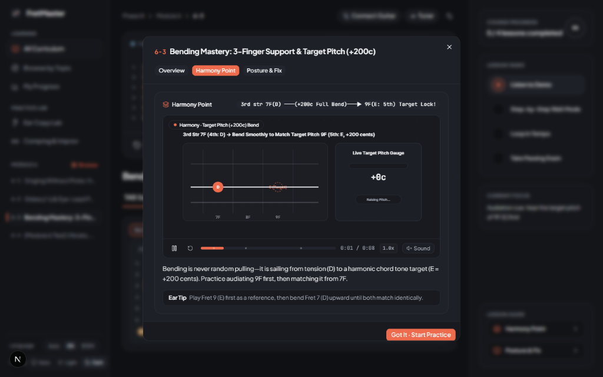
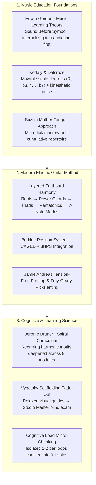
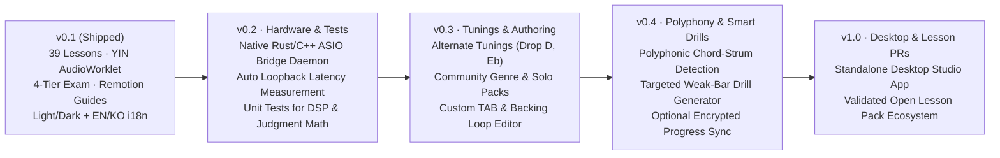

<div align="center">

# FretMaster Studio

<p>
  <a href="README.md"></a>
  <a href="README.ko.md"></a>
</p>

**From day-one fundamentals to tactile fretboard harmony, ultra-low-latency DSP feedback, blind ear transcription, and fearless improvisation.**  
An open electric guitar learning studio engineered to tear down every barrier between beginners and musical freedom.

<p>
  
</p>

<p>
  <a href="https://fretmaster-studio.vercel.app/"></a>
  <a href="https://nextjs.org/"></a>
  <a href="https://react.dev/"></a>
  <a href="https://www.typescriptlang.org/"></a>
  <a href="https://www.remotion.dev/"></a>
  
  
  
  <a href="LICENSE"></a>
</p>

<p>
  <a href="https://fretmaster-studio.vercel.app/"><strong>Try Live Studio</strong></a> ·
  <a href="#studio-preview">Preview</a> ·
  <a href="#why-fretmaster-studio-exists">Origin &amp; Philosophy</a> ·
  <a href="#applied-music-pedagogy--spiral-harmony">Pedagogy</a> ·
  <a href="#core-capabilities">Features</a> ·
  <a href="#complete-curriculum-4-phases--9-modules--39-lessons">Curriculum</a> ·
  <a href="#roadmap">Roadmap</a> ·
  <a href="#contribute-with-us">Contribute</a> ·
  <a href="#guide-for-ai-coding-agents">AI Agent Guide</a> ·
  <a href="#copyright--licensing">License</a> ·
  <a href="#quick-start">Quick Start</a>
</p>

</div>

---

> [!IMPORTANT]
> **Our One-Line Promise**  
> *"Instead of trapping harmony inside dry sheet-music memorization, **sound, finger distance, harmonic reason, and creative improvisation** lock together right beneath your fingertips across every scale box you touch."*

<br />

## Studio Preview

| Light Studio · 3-Column Learning Workspace (`4-2` Relative Keys) | Dark Studio · Remotion Harmony &amp; Posture Motion Guide (`6-3` Bends) |
| :---: | :---: |
|  |  |
| *System-matched Light theme · 4-finger earth palette · Synced chord &amp; TAB score* | *Dark theme · Animated bending pitch arc · Real-time Web Audio synth playback* |

---

## Why FretMaster Studio Exists

Almost every self-taught electric guitarist hits the exact same wall early on:

1. **A broken wall between technique and harmony**: Grinding cold TAB numbers teaches muscle memory without understanding—leaving players wondering *"Why does this fret sound sweet over an Am chord?"* or *"Why do power chords drop the 3rd?"*
2. **Cluttered, high-fatigue practice apps**: Conventional guitar software crowds the viewport with neon glows, dozens of knobs, and noisy overlays that pull focus away from the fundamentals that actually matter on day one: relaxed finger curvature, alternate picking arcs, and clean muting.
3. **Sluggish mic lag &amp; unforgiving grading**: High audio latency or rigid pass/fail timers punish beginners before they have even built steady picking confidence, killing motivation fast.

**FretMaster Studio** was designed from the ground up around **three founding principles**:

- **Protect Day-One Physical Fundamentals**: Open-string picking pendulums, perpendicular fingertip pressure 2 mm behind the fretwire, anchor-finger geometry, and 4-finger independence are never skipped or glossed over.
- **Tactile Fretboard Harmony**: Every module threads foundational music theory directly into finger geometry—helping players *feel* that `+1 fret = 1 half step` and `Pentatonic + 2 Color Notes = 7-Note Scale` without heavy textbook jargon.
- **From Mechanical Imitation to Musical Independence**: Inspired by proven cognitive science and **progressive scaffolding fade-out**, learners advance seamlessly from guided note-by-note Wait Mode all the way to blind studio exams, blind ear transcription, and live improvisation.

---

## Applied Music Pedagogy &amp; Spiral Harmony

Every exercise, animated explainer, and audio judgment tier in FretMaster Studio rests on an integrated pedagogy stack combining classical music education, modern electric guitar methodology, and cognitive learning science:



### The 5-Layer Spiral Harmony Architecture

| Harmonic Layer | Concept on the Neck | What Learners Grasp Under Their Fingers | Modules |
| :--- | :--- | :--- | :--- |
| **Layer 1** | Half Step (`+1F`) vs Whole Step (`+2F`), Octaves | Fret distance *is* pitch interval, and why the `3G → 2B` tuning warp shifts patterns by 1 fret | `Module 1 – 2` |
| **Layer 2** | Power Chords (`1+5+8`) &amp; Major/Minor Triads | Why overdrive favors pure 5ths, and how lowering one finger by 1 fret flips happy to sorrowful | `Module 3` |
| **Layer 3** | 5-Note Pentatonic Frame &amp; Relative Keys | Why the exact same `5–8F` box sounds dark in `Am` and bright in `C` depending on root resolution | `Module 4` |
| **Layer 4** | Pentatonic + 2 Color Notes = 7-Note Scales | Expanding familiar 5-note boxes by dropping just `2 &amp; b6` (or `b5` blue note / `#7`) into gaps | `Module 5 – 7` |
| **Layer 5** | Tension Resolution &amp; Chord-Tone Landing | Expressive bending and solo phrasing as controlled tension resolving onto the backing chord's `3rd`, `7th`, or `Root` | `Module 6 – 9` |

---

## Core Capabilities

| Capability | Technical Implementation &amp; Learning Experience |
| :--- | :--- |
| **Bilingual EN / KO Localization** | Automatic OS/browser language detection (`navigator.language`) with an instant **Auto / EN / 한국어** switcher in the sidebar (`fretmaster_locale`), translating all UI controls, 39 lessons, 230+ coaching notes, and SVG animations live |
| **Low-Latency YIN DSP Engine** | `128-sample AudioWorkletProcessor` running off the main thread (`68–1320 Hz`, `±1 cent` parabolic interpolation), RMS + high-frequency transient onset detection, channel routing (`Ch1 / Ch2 / Mono`), noise gate, and optional local **ASIO Bridge (`ws://127.0.0.1:9420`)** |
| **4-Tier Progressive Judgment** | **Relaxed** (`±110ms / ±45c`) → **Standard** (`±65ms / ±30c`, unlocks next lesson) → **Tight** (`±35ms / ±18c`) → **Studio Master** (`±18ms / ±10c`, blind playthrough with fretboard hints hidden) |
| **Remotion Explainer Animations** | Auto-played on lesson entry and always reachable from the bottom-right **Lesson Guide**: **11 Harmony visuals** &amp; **8 Biomechanical Posture scenes** with `0.75x` slow motion, timeline scrubbing, and synchronized Web Audio cues |
| **Web Audio Guitar Synth &amp; Backing** | Dual-oscillator/filter electric guitar synthesizer (`Clean`, `Crunch`, `Lead` tube-saturation curves) + 25ms lookahead multitrack transport (Drums, Bass, Chord Comping, Metronome, Wait-for-Note mode, loop range, `+5 BPM` auto-ramp) |
| **Phase IV Musical Freedom Studio** | Blind **Ear Copy Deck** with 3 progressive hint levels, **Live Improvisation Analyzer** scoring Scale Fit, Chord-Tone Landing, Phrasing Space, and Articulation, plus **Hum-to-Fret** voice-to-fingering mapper |
| **Restrained Light &amp; Dark Studio UI** | Zero neon glow, zero Unicode emojis, Monochrome + Calm Coral (`#e85d3f`) palette, `Plus Jakarta Sans` + `Pretendard Variable` + `JetBrains Mono` typography, automatic OS dark/light detection |

---

## Complete Curriculum (4 Phases · 9 Modules · 39 Lessons)

Beginners can progress linearly through passing exams (`Standard` tier), or flip **Free Explore** in the Curriculum Modal to jump straight into any technique, genre, or solo breakdown.

| Phase | Focus Area | Modules | Lessons |
| :--- | :--- | :--- | :---: |
| **Phase I** | Foundations, Tension-Free Fretting, Alternate Picking &amp; Octaves | `Module 1 – 2` | `8` |
| **Phase II** | Power Chords, Palm Muting, Triads, Pentatonic Boxes &amp; 7-Note Scales | `Module 3 – 5` | `12` |
| **Phase III** | Legato, Support Bending, 5 Genre Comping Styles &amp; Iconic Solos Lv.1–6 | `Module 6 – 8` | `15` |
| **Phase IV** | Blind Ear Transcription, Live Comp↔Solo Jamming &amp; Hum-to-Fretboard | `Module 9` | `4` |

<details>
<summary><strong>Expand Full 9-Module · 39-Lesson Syllabus</strong></summary>

- **Module 1 · First Notes &amp; Fretboard Physics** (`1-1` – `1-4`)
  - `1-1` The 6 Open Strings &amp; Down/Up Picking Pendulum
  - `1-2` Buzz-Free First Frets: Index, Middle, Ring &amp; Half/Whole Steps
  - `1-3` Anchor Finger Law &amp; 1-2-3 Chromatic Walking
  - `1-4` [Module 1 Test] First 3-Finger Single-Note Rock Riff
- **Module 2 · Chromatic Mechanics &amp; Independence** (`2-1` – `2-4`)
  - `2-1` Waking Up the Pinky: 1-2-3-4 Chromatic Spider Walk
  - `2-2` Ring &amp; Pinky Neural Split: 1-3-2-4 &amp; 1-4-2-3 Permutations
  - `2-3` String Crossing &amp; Inside / Outside Alternate Picking
  - `2-4` [Module 2 Test] String Skipping &amp; Fretboard Octave Geometry
- **Module 3 · Power Chords, Triads &amp; Rhythm Pocket** (`3-1` – `3-4`)
  - `3-1` Power Chords (1-3-4 Grip) &amp; Index String Muting
  - `3-2` Right-Hand Palm Mute &amp; 8th-Note Dynamic Accents
  - `3-3` Adding Emotion to Chords: Major vs Minor Triads
  - `3-4` [Module 3 Test] I - V - vi - IV Pop &amp; Rock Rhythm Progression
- **Module 4 · Pentatonic Mastery &amp; Relative Keys** (`4-1` – `4-4`)
  - `4-1` Golden Key of the Fretboard: A Minor Pentatonic Box 1
  - `4-2` One Box, Two Moods: A Minor vs C Major Relative Keys
  - `4-3` Breaking Out of the Box: Pos 1 to Pos 2 Diagonal Slide
  - `4-4` [Module 4 Test] 4-Note Staircase Sequence &amp; Index Rolling
- **Module 5 · Full Scales, 3NPS &amp; Chord-Tone Targeting** (`5-1` – `5-4`)
  - `5-1` Just Add 2 Notes: Full 7-Note A Natural Minor Scale
  - `5-2` Soul of the Blues: Blue Note (b5) &amp; Chromatic Resolution
  - `5-3` Highway to Speed: 3-Notes-Per-String (3NPS)
  - `5-4` [Module 5 Test] Landing on Chord Tones Across Changes
- **Module 6 · Expressive Articulation &amp; Harmonic Bends** (`6-1` – `6-4`)
  - `6-1` Singing Without Picks: Hammer-On (H) &amp; Pull-Off (P) Legato
  - `6-2` Slides (`/` `\`) &amp; Eye-Lead Position Shifting
  - `6-3` Bending Mastery: 3-Finger Support &amp; Target Pitch (`+200c`)
  - `6-4` [Module 6 Test] Vibrato, Unison Bends &amp; Hendrix Double Stops
- **Module 7 · Genre Harmony, Comping &amp; Riffs** (`7-1` – `7-5`)
  - `7-1` [Blues] 12-Bar Blues (I7-IV7-V7) Shuffle &amp; Call-Response
  - `7-2` [Classic Rock] Open Power Chords &amp; I - bVII - IV Mixolydian
  - `7-3` [Pop &amp; Funk] High-Register Triad Inversions (Voice Leading)
  - `7-4` [Metal &amp; Neoclassical] Pedal Point &amp; Harmonic Minor (`#7`)
  - `7-5` [Module 7 Test · Neo-Soul &amp; Jazz] 3-Note Shell Voicings (`R-3-7`)
- **Module 8 · Famous Solos Breakdown (Lv.1–6)** (`8-1` – `8-6`)
  - `8-1` [Solo Lv.1] Melodic Rock Ballad (*Knockin'* Style)
  - `8-2` [Solo Lv.2] Grunge Vocal Melody (*Teen Spirit* Style)
  - `8-3` [Solo Lv.3] B.B. King Sweet Box Blues (*Thrill Is Gone* Style)
  - `8-4` [Solo Lv.4] David Gilmour Soaring Bends (*Comfortably Numb* Style)
  - `8-5` [Solo Lv.5] Slash Arpeggios &amp; Harmonic Minor Turn (*Sweet Child* Style)
  - `8-6` [Module 8 Test · Lv.6] Page Climax Loop &amp; Johnson 5-Note Cascade
- **Module 9 · Ear Copy, Comping &amp; Improvisation Lab** (`9-1` – `9-4`)
  - `9-1` [Ear Copy Deck 1] Transcribing Melodies Inside Box 1
  - `9-2` [Ear Copy Deck 2] Finding Chord Progressions via Bass Roots
  - `9-3` [Comping Studio] Triad Comping &amp; Double-Stop Fills Over Groove
  - `9-4` [Graduation Master Lab] Free Improv, Comp↔Solo Switch &amp; Hum Mapper

</details>

---

## Roadmap

Built around the completed `v0.1` core studio + bilingual EN/KO overhaul, FretMaster Studio aims to grow alongside contributors into a full open-source guitar learning ecosystem:



| Milestone | Focus | Planned Deliverables |
| :--- | :--- | :--- |
| **v0.1** *(Current)* | **Core Studio + Global i18n** | 39 bilingual lessons, AudioWorklet YIN DSP, 4 judgment tiers, Remotion visual guides, Light/Dark UI, EN/KO auto-detection |
| **v0.2** | **Hardware Ecosystem &amp; Quality** | Open-source local **ASIO WebSocket Bridge (`ws://127.0.0.1:9420`)** daemon in Rust/C++, automated audio loopback calibration, DSP unit test suite |
| **v0.3** | **Tunings &amp; Creator Tools** | `Drop D`, `Eb Standard`, and open-tuning fretboard overlays, expanded Blues/Jazz/City-Pop packs, custom progression &amp; TAB loop authoring |
| **v0.4** | **Polyphonic Strums &amp; Adaptive Coaching** | Multi-pitch spectral chord verifier beyond single-note YIN + spaced-repetition weak-bar practice queues |
| **v1.0** | **Desktop Packaging &amp; Open Lesson Packs** | Standalone desktop bundle free from browser permission sandboxes + schema-validated community lesson PR contributions |

---

## Contribute With Us

Developers, audio DSP engineers, guitar teachers, UI designers, and learners practicing their first riffs—every single issue, idea, bug report, or PR helps move this project forward!

### Great Places to Jump In (Good First Contributions)

- **Add Lessons, Genre Grooves, or Solo Studies**: Use the `buildNotes` factory documented in [docs/03-CURRICULUM.md](docs/03-CURRICULUM.md) along with bilingual entries in [src/data/curriculumEn.ts](src/data/curriculumEn.ts) and [src/data/coachingNotesEn.ts](src/data/coachingNotesEn.ts).
- **Author New Remotion Motion Scenes**: Extend [HarmonyExplainerComposition.tsx](src/components/animations/HarmonyExplainerComposition.tsx) or [PostureExplainerComposition.tsx](src/components/animations/PostureExplainerComposition.tsx) using `var(--*)` CSS tokens for techniques like sweep picking, barre chords, or tapping (see [docs/05-ANIMATIONS.md](docs/05-ANIMATIONS.md)).
- **DSP &amp; Native ASIO Bridge**: Build the cross-platform `ws://127.0.0.1:9420` native ASIO/CoreAudio bridge daemon matching [docs/04-AUDIO-DSP.md](docs/04-AUDIO-DSP.md), or tune low-string (`E2`/`A2`) YIN octave-error rejection.
- **Beginner UX, Accessibility &amp; Additional Locales**: Plug in a guitar, tell us where judgment felt strict or terminology felt confusing, or help bring FretMaster Studio to a third language via `src/lib/i18n.tsx`.

### Contribution Workflow &amp; Design Standards

1. **Fork** the repository and create a descriptive feature branch (`feat/barre-chord-scene`, `fix/low-e-yin-threshold`, etc.).
2. Read the single relevant module doc under [`docs/INDEX.md`](docs/INDEX.md) before editing.
3. Preserve project-wide UI invariants:
   - Keep Light &amp; Dark theme parity via semantic CSS variables (`var(--*)`).
   - Use strictly `lucide-react` or inline monoline SVGs—never add Unicode emojis or Dingbats inside `src/`, and never add neon glow shadows or lesson subtitles.
   - Support both `'en'` and `'ko'` locales cleanly via `useLocale()` (`tr(en, ko)`).
4. Verify before submitting your Pull Request:
   ```bash
   npm run build
   npm run lint
   ```
5. Open a **Pull Request** describing what you changed, why, and screenshots in both Light and Dark modes (if UI changed).

---

## Quick Start

### Prerequisites
- **Node.js** 20+
- **Guitar Input (any one)**: Audio interface with Hi-Z instrument input (recommended), USB guitar cable, or built-in/external microphone (`http://localhost:3000` with browser microphone permission granted)

### Run Locally

```bash
# 1. Clone the repository
git clone https://github.com/srain0626/fretmaster-studio.git
cd fretmaster-studio

# 2. Install dependencies
npm install

# 3. Start the Studio dev server (http://localhost:3000)
npm run dev
```

<details>
<summary><strong>Project Directory Tree &amp; Technical Architecture Overview</strong></summary>

```text
fretmaster-studio/
├── AGENTS.md                         # AI agent entry guardrails & docs router
├── LICENSE                           # GNU GPL-3.0 full text
├── README.ko.md                      # Korean README edition
├── docs/                             # Low-token modular docs (INDEX -> 01..06)
├── public/worklets/
│   └── guitarPitchWorklet.js         # 128-sample AudioWorklet YIN pitch/onset DSP
└── src/
    ├── types/guitar.ts               # Canonical domain & telemetry TypeScript models
    ├── lib/
    │   ├── i18n.tsx                  # EN/KO LocaleProvider, navigator detection & tr()
    │   ├── musicTheory.ts            # MIDI, frequency, interval, muted 4-finger palette
    │   ├── guitarSynthEngine.ts      # Web Audio guitar synth & lookahead transport
    │   └── lowLatencyAudioEngine.ts  # Worklet/Analyser/ASIO capture + scoring math
    ├── data/
    │   ├── modulesMeta.ts            # 9 modules metadata
    │   ├── curriculumEn.ts           # English categories, modules & 39-lesson lookup
    │   ├── coachingNotesEn.ts        # English lookup table for all note coaching tips
    │   ├── lessonsPhase1.ts – 4.ts   # Curriculum lessons (m1-1..m9-4)
    │   └── curriculumData.ts         # Unified ALL_LESSONS + localizeLesson helpers
    ├── app/
    │   ├── globals.css               # Tailwind v4 + HeroUI + Light/Dark CSS vars
    │   ├── layout.tsx                # Fonts, zero-flash theme script, LocaleProvider
    │   └── page.tsx                  # 3-column Studio client orchestrator
    └── components/
        ├── ui/                       # 15 shadcn/base-ui primitives
        ├── icons/GuitarSvgIcons.tsx  # Monoline SVG helpers & Radar chart
        ├── motion/StudioMotion.tsx   # Framer Motion springs & MotionConfig
        ├── curriculum/               # CurriculumSidebar + modal, SkillAnalyticsDialog
        ├── fretboard/                # ElectricFretboard (22F SVG), TabTimeline
        ├── audio/                    # LivePitchTelemetryBar, ChromaticTunerDialog, AudioInterfaceModal
        ├── practice/                 # LessonGuideDialog, MasteryReportDialog
        └── animations/               # ExplainerVideoShell, Harmony & Posture Remotion SVG compositions
```

</details>

---

## Guide for AI Coding Agents

This repository ships with a **Low-Token Modular Documentation System** specifically structured so AI coding agents (Claude Code, Codex, Cursor, Gemini CLI, Antigravity) can inspect, edit, and verify any part of the app with minimal context consumption.

> [!TIP]
> **AI Agent 3-Step Protocol**
> 1. Always read [`AGENTS.md`](AGENTS.md) → [`docs/INDEX.md`](docs/INDEX.md) first (~100 lines total).
> 2. **Never bulk-read** `src/data/lessonsPhase*.ts` (2,600+ lines) or `src/app/page.tsx` (1,500+ lines). Open only the **single task-mapped doc** (~50–70 lines) below.
> 3. Before finishing any edit, run the build + emoji-zero verification gate below.

### Task-to-Doc Routing Table (`docs/`)

| Task Domain | Read ONLY | Length | Covered Invariants &amp; File Map |
| :--- | :--- | :---: | :--- |
| Architecture, State, Storage &amp; i18n | [`docs/01-ARCHITECTURE.md`](docs/01-ARCHITECTURE.md) | `~70L` | Theme boot script, `localStorage` keys (`fretmaster_locale`, `fretmaster_theme`, etc.), 3-col layout, 6 modes |
| UI Tokens, Fonts &amp; Component Quirks | [`docs/02-UI-SYSTEM.md`](docs/02-UI-SYSTEM.md) | `~56L` | Light/Dark CSS variables, 4-finger colors, HeroUI v3 vs Base UI/shadcn pitfalls |
| Lessons, Modules &amp; Curriculum | [`docs/03-CURRICULUM.md`](docs/03-CURRICULUM.md) | `~52L` | All 39 lesson IDs, `buildNotes` factory, progressive unlock &amp; exam passing rules |
| Audio DSP, Synth &amp; Judgment Tiers | [`docs/04-AUDIO-DSP.md`](docs/04-AUDIO-DSP.md) | `~52L` | `AudioWorklet` YIN pitch/onset DSP, ASIO bridge (`:9420`), `JUDGMENT_TIERS` |
| Remotion Motion &amp; Audio Cues | [`docs/05-ANIMATIONS.md`](docs/05-ANIMATIONS.md) | `~59L` | `ExplainerVideoShell` `resetKey`, 11 Harmony / 8 Posture scenes, `720x320` SVG safe bounds |
| CLI Commands, PowerShell &amp; QA | [`docs/06-MAINTENANCE-RUNBOOK.md`](docs/06-MAINTENANCE-RUNBOOK.md) | `~47L` | Windows PowerShell `;` chaining, top 6 common traps, live browser QA checklist |

### Non-Negotiable Agent Guardrails

1. **Zero Emoji / Dingbat (`src/` wide):** Strictly forbid Unicode emojis and Dingbats (`\u2600-\u27BF`) anywhere inside `src/`. Use `lucide-react` or inline vector `<path>`.
2. **Design Restraint &amp; Dual Theme Parity:** No neon glow shadows and no lesson subtitles. Use semantic CSS variables (`var(--card)`, `var(--foreground)`, `var(--primary)`) inside all components and SVG elements for full Light/Dark contrast.
3. **Protect HeroUI CSS Cascade:** Keep `--muted` as a neutral surface gray and preserve `.tabs__tab:not([data-selected="true"]) { color: var(--muted-foreground); }` in `src/app/globals.css`.
4. **Preserve `AGENTS.md` Next.js Block:** Never delete `<!-- BEGIN:nextjs-agent-rules --> ... <!-- END:nextjs-agent-rules -->`.
5. **Strict TypeScript Signatures:** Pass valid `ArticulationType` values to `playSingleGuitarNote`, always pass 2 args to `getIntervalLabel(midi, rootPitchClass)`, and keep i18n coverage intact when adding UI copy (`tr(en, ko)`).
6. **Mandatory Verification Gate:** After any code change, run build + zero-emoji scan (use `;` instead of `&&` on Windows PowerShell 5.1):
   ```powershell
   npm run build; if ($LASTEXITCODE -eq 0) { node -e "const fs=require('fs'),path=require('path'); let hits=0; function walk(d){for(const f of fs.readdirSync(d)){const p=path.join(d,f);if(fs.statSync(p).isDirectory())walk(p);else if(/\.(ts|tsx|css)$/.test(f)){const t=fs.readFileSync(p,'utf8'); const m=t.match(/[\uD83C-\uDBFF][\uDC00-\uDFFF]|[\u2600-\u27BF]/g); if(m){hits+=m.length;console.log(p,m);}}}} walk('src'); console.log('Total emoji/dingbat hits:',hits);" }
   ```

---

## Copyright &amp; Licensing

### 1. Source Code License (`GNU GPL-3.0`)

```text
FretMaster Studio
Copyright (C) 2026 Ray Kim
```

This program is free software distributed under the terms of the **[GNU General Public License v3.0 (GPL-3.0)](LICENSE)**.

- **Freedoms Granted**: You may run, study, copy, modify, and redistribute the source code for personal, educational, or commercial purposes.
- **Copyleft Requirement**: If you distribute or publicly host modified or derivative versions, you must release the **complete corresponding source code under the same GPL-3.0 license**, retaining copyright notices and change disclosures.
- Distributed **"AS IS"** without warranty of any kind. See [`LICENSE`](LICENSE) for full legal terms.

### 2. Original Educational Etudes Notice

- All notation, chord progressions, and synthesized audio examples in **Module 7 (Genre Academy)** and **Module 8 (Famous Solos Breakdown `8-1 – 8-6`)** **do not copy or redistribute** copyrighted master recordings, sheet music, or paid commercial transcriptions.
- Every study pattern is an **original pedagogical etude** authored specifically to demonstrate harmonic devices and guitar techniques using real-time Web Audio synthesis.
- Artist names, song titles, and brand references cited as stylistic context remain trademarks and intellectual property of their respective owners.

### 3. Third-Party Open Source &amp; Typography Attribution

| Component | Role | License |
| :--- | :--- | :--- |
| `Next.js`, `React`, `Framer Motion`, `Tailwind CSS` | Framework, runtime, motion, styling | `MIT` |
| `@heroui/react`, `@heroui/styles` | Studio Tabs &amp; Surface components | `Apache-2.0` |
| `lucide-react` | Monoline vector icons | `ISC` |
| `Pretendard`, `Plus Jakarta Sans`, `JetBrains Mono` | Korean, Latin display, and monospace fonts | `SIL OFL 1.1` |
| `remotion`, `@remotion/player` | Interactive Harmony &amp; Posture motion player | [`Remotion License`](https://github.com/remotion-dev/remotion/blob/main/LICENSE.md) *(free for individuals, nonprofits, and small teams of ≤3 employees; verify terms for larger commercial organizations)* |

---

<div align="center">
  <sub>Made for beginners picking up an electric guitar for the first time — Built with clarity, harmony, and zero clutter.</sub>
</div>
