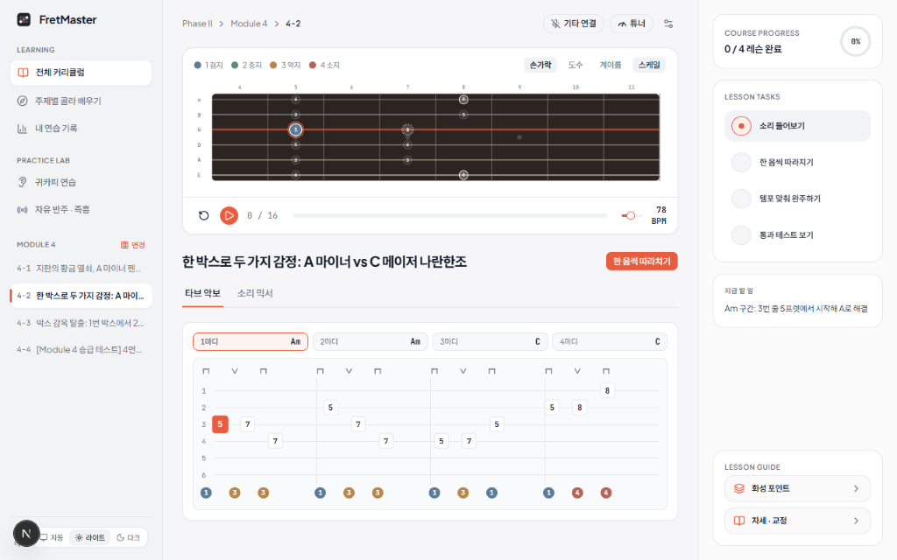
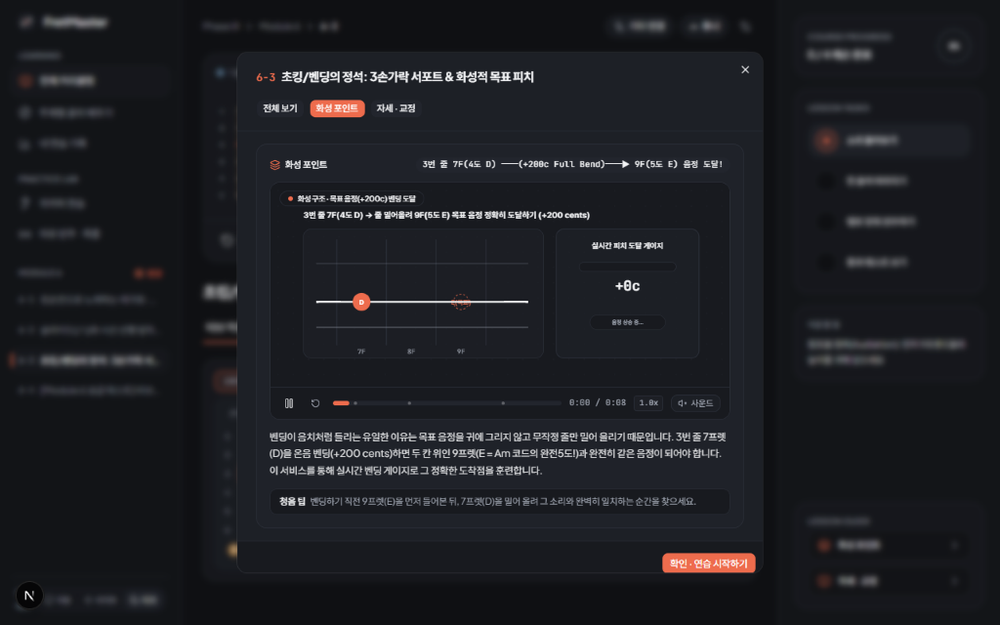
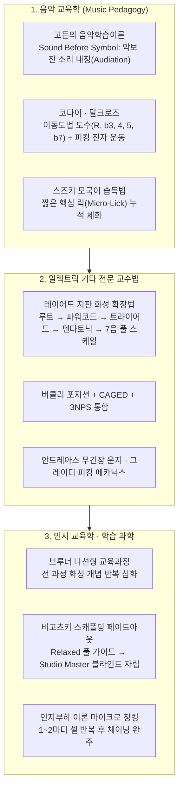
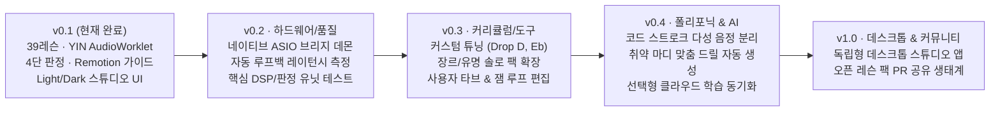

<div align="center">

# FretMaster Studio

**초심자 기본기부터 손끝으로 깨우치는 지판 화성학, 저지연 DSP 실시간 판정, 귀카피·즉흥 연주까지.**  
일렉트릭 기타 학습의 모든 장벽을 낮추기 위해 설계된 오픈 스튜디오 플랫폼

<p>
  
</p>

<p>
  <a href="https://nextjs.org/"></a>
  <a href="https://react.dev/"></a>
  <a href="https://www.typescriptlang.org/"></a>
  <a href="https://www.remotion.dev/"></a>
  
  
  <a href="LICENSE"></a>
</p>

<p>
  <a href="#스튜디오-프리뷰">프리뷰</a> ·
  <a href="#프로젝트-기획-배경과-목적">기획 배경</a> ·
  <a href="#적용된-음악-교육학--나선형-화성-설계">교육학 설계</a> ·
  <a href="#주요-기능">핵심 기능</a> ·
  <a href="#전체-커리큘럼-4-phases--9-modules--39-lessons">커리큘럼</a> ·
  <a href="#앞으로의-로드맵">로드맵</a> ·
  <a href="#함께-만들어가요-기여-가이드">기여 가이드</a> ·
  <a href="#ai-agent를-위한-개발--유지보수-가이드">AI Agent 가이드</a> ·
  <a href="#저작권-및-라이선스-안내">저작권 · 라이선스</a> ·
  <a href="#빠른-시작">빠른 시작</a>
</p>

</div>

---

> [!IMPORTANT]
> **프로젝트의 한 줄 약속**  
> *"화성학을 오선지 위의 지루한 암기 과목으로 떼어놓지 않고, 내가 짚은 손가락의 간격과 스케일 박스 안에서 **소리 → 운지 → 화성 원리 → 자유 연주**가 하나로 이어지는 일렉트릭 기타 입문 스튜디오"*

<br />

## 스튜디오 프리뷰

| Light Studio · 3단 학습 워크스페이스 (`4-2` 나란한조) | Dark Studio · Remotion 화성/자세 모션 가이드 (`6-3` 벤딩) |
| :---: | :---: |
|  |  |
| *시스템 연동 Light 테마 · 4색 운지 지판 · 마디별 코드 & TAB 동기화* | *Dark 테마 · 실시간 벤딩 피치 게이지 애니메이션 · Web Audio 동기화* |

---

## 프로젝트 기획 배경과 목적

많은 일렉트릭 기타 입문자가 비슷한 지점에서 좌절합니다.

1. **기본기와 화성학의 단절**: 타브(TAB) 숫자만 기계적으로 따라 치다 보면 *"왜 이 프렛이 이 코드 위에서 예쁜 소리가 나는지"*, *"왜 파워코드에서는 3도를 빼는지"* 모른 채 응용력을 잃고 정체기에 빠집니다.
2. **과도한 시각 피로와 불친절한 도구**: 기존 연습 툴들은 화려한 네온 효과와 복잡한 믹서/버튼을 화면 가득 띄워, 정작 초심자가 지금 집중해야 할 **손가락 모양·피킹 방향·자세 교정**을 방해합니다.
3. **느린 마이크 인식과 경직된 판정**: 박자를 조금만 늦춰도 무조건 오답 처리하거나 레이턴시가 커서 연주감이 떨어지면 흥미가 빠르게 식습니다.

**FretMaster Studio**는 이 세 가지 문제를 해결하기 위해 다음 **3가지 원점 원칙**에서 출발했습니다.

- **초심자 정통 기본기 수호**: 개방현 피킹 진자 운동, 프렛쇠 2mm 뒤 수직 압착, 앵커 핑거, 4손가락 독립 등 일렉트릭 기타의 물리적 토대를 절대 건너뛰지 않습니다.
- **손끝으로 깨우치는 지판 화성학 (Tactile Fretboard Harmony)**: 모든 모듈과 레슨에 기초 화성학을 자연스럽게 녹여, *"손가락 1칸=반음"*, *"펜타토닉=마이너 코드 톤+2음"*임을 연주하며 체감하게 합니다.
- **모방에서 음악적 자립으로 (From Mechanics to Musical Freedom)**: 검증된 음악 교육학과 인지 과학의 **점진적 스캐폴딩 해제(Scaffolding Fade-out)**를 통해, 풀 가이드 입문에서 블라인드 귀카피와 자유 즉흥 연주까지 자연스럽게 끌어올립니다.

---

## 적용된 음악 교육학 · 나선형 화성 설계

단순한 코드 나열이 아닌, **고전 음악 교육학 + 현대 일렉트릭 기타 교수법 + 인지 학습 과학**을 결합한 설계 위에서 모든 인터랙션이 동작합니다.



### 전 과정에 녹아든 '5단계 지판 화성 레이어링'

| 화성 계층 | 지판 위 핵심 개념 | 학습자가 손끝으로 깨우치는 원리 | 연결 모듈 |
| :--- | :--- | :--- | :--- |
| **Layer 1** | 반음(`+1F`) vs 온음(`+2F`), 옥타브 | 손가락 간격이 곧 음정 거리이며 `3G→2B`만 4프렛 차이인 튜닝 구조 이해 | `Module 1 ~ 2` |
| **Layer 2** | 파워코드(`1+5+8`) & 장/단 3화음 | 디스토션에서 3도를 빼는 이유, 3도 1프렛 이동만으로 밝음/어두움 반전 | `Module 3` |
| **Layer 3** | 펜타토닉 5음 골격 & 나란한조 | 같은 `5~8F` 박스도 루트(`A` vs `C`)에 따라 마이너와 메이저로 뒤바뀌는 원리 | `Module 4` |
| **Layer 4** | 펜타토닉 + 컬러 노트 2음 = 7음 스케일 | 새로 외우지 않고 기존 5음 빈칸에 `2도·6도(또는 b5 블루노트, #7)`만 채워 확장 | `Module 5 ~ 7` |
| **Layer 5** | 긴장음 해소 & 코드 톤 타겟팅 | 벤딩과 프레이징은 비화성음에서 배경 코드의 `3도/7도/루트`로 착지하는 서사 | `Module 6 ~ 9` |

---

## 주요 기능

| 영역 | 구현된 핵심 기술 및 학습 경험 |
| :--- | :--- |
| **ASIO 호환 저지연 DSP 엔진** | `128-sample AudioWorkletProcessor` 별도 오디오 스레드에서 YIN 알고리즘(`68~1320 Hz`, `±1 cent` 포물선 보간), RMS/고주파 트랜지언트 온셋 감지, 채널 라우팅(`Ch1 / Ch2 / Mono`), 노이즈 게이트, 로컬 **ASIO Bridge (`ws://127.0.0.1:9420`)** 지원 |
| **4단계 스캐폴딩 정밀 판정** | **Relaxed**(`±110ms/±45c`) → **Standard**(`±65ms/±30c`, 다음 레슨 해금 기준) → **Tight**(`±35ms/±18c`) → **Studio Master**(`±18ms/±10c`, 지판 힌트 소거 블라인드 시험) |
| **Remotion 맞춤형 설명 애니메이션** | 모든 레슨 진입 시 **화성 포인트(11종)**와 **자세·교정 생체역학(8종)** 모션 영상이 자동 재생되며, `0.75x` 슬로우모션, 타임라인 스크러빙, 실제 기타 신스 사운드 동기화 제공 |
| **내장 기타 신스 & 멀티트랙** | `Clean / Crunch / Lead` 3종 진공관 포화 커브 기반 일렉기타 신스 + 드럼/베이스/코드 백킹 25ms lookahead 트랜스포트(`Wait-for-Note` 대기 실습, 마디 구간 루프, `+5 BPM` 자동 가속) |
| **Phase IV 자립 스튜디오** | 타브 숫자가 가려진 **블라인드 귀카피 데크** + 3단계 힌트, **드럼·베이스 자유 반주/즉흥 잼**(`Harmonic Fit`, `Chord-Tone Resolution` 실시간 평가), **허밍-투-프렛보드**(음성 허밍을 최적 운지로 변환) |
| **절제된 Light / Dark 스튜디오 UI** | 네온 글로우·이모지·부제목을 배제한 Monochrome + Calm Coral(`#e85d3f`) 디자인, `Plus Jakarta Sans` + `Pretendard Variable` + `JetBrains Mono` 타이포그래피, 시스템 테마 자동 감지 |

---

## 전체 커리큘럼 (4 Phases · 9 Modules · 39 Lessons)

초보자가 단계별로 순차 해금(`Standard` 기준 통과)할 수도 있고, 커리큘럼 탐색기의 **자유 탐색** 토글로 원하는 주제를 바로 학습할 수도 있습니다.

| Phase | 주제 및 교육 초점 | 모듈 구성 | 레슨 수 |
| :--- | :--- | :--- | :---: |
| **Phase I** | 입문 기본기, 무긴장 운지, 크로매틱 독립 & 음정 거리감 | `Module 1 ~ 2` | `8` |
| **Phase II** | 파워코드, 팜뮤트, 트라이어드, 펜타토닉 나란한조 & 7음 풀 스케일 | `Module 3 ~ 5` | `12` |
| **Phase III** | 레가토·서포트 벤딩, 5대 장르 화성·리프 & 거장 솔로 Lv.1~6 해부 | `Module 6 ~ 8` | `15` |
| **Phase IV** | 블라인드 귀카피, 자유 반주 & 즉흥 연주 · 허밍 매핑 | `Module 9` | `4` |

<details>
<summary><strong>전체 9개 모듈 · 39개 레슨 상세 목차 펼쳐보기</strong></summary>

- **Module 1. 첫 줄 울리기와 손 모양 기초** (`1-1` ~ `1-4`)
  - `1-1` 개방현 6형제와 다운/업 피킹 진자 운동
  - `1-2` 버징 없는 첫 프렛 짚기: 검지·중지·약지와 반음/온음
  - `1-3` 앵커 핑거(Anchor Finger) 법칙과 1-2-3 워킹
  - `1-4` [승급 테스트] 3손가락으로 연주하는 첫 단선율 록 리프
- **Module 2. 크로매틱 & 4손가락 독립** (`2-1` ~ `2-4`)
  - `2-1` 소지(4번 손가락) 깨우기: 1-2-3-4 크로매틱 스파이더
  - `2-2` 약지·소지 신경 분리: 1-3-2-4 & 1-4-2-3 순열 에튀드
  - `2-3` 줄 이동(String Crossing)과 인사이드/아웃사이드 피킹
  - `2-4` [승급 테스트] 스트링 스키핑 & 지판 옥타브 도형 찾기
- **Module 3. 파워코드, 트라이어드 & 리듬 뮤트** (`3-1` ~ `3-4`)
  - `3-1` 록과 메탈의 심장, 파워코드(1-3-4 운지)와 줄 뮤트
  - `3-2` 오른손 팜뮤트(Palm Mute)와 8비트 다이나믹 악센트
  - `3-3` 파워코드에 감정을 입히다: 장3화음 vs 단3화음 트라이어드
  - `3-4` [승급 테스트] I - V - vi - IV 실전 록/팝 백킹 리듬
- **Module 4. 펜타토닉 스케일 & 나란한조** (`4-1` ~ `4-4`)
  - `4-1` 지판의 황금 열쇠, A 마이너 펜타토닉 1번 박스
  - `4-2` 한 박스로 두 가지 감정: A 마이너 vs C 메이저 나란한조
  - `4-3` 박스 감옥 탈출: 1번 박스에서 2번 박스로 대각선 슬라이드 런
  - `4-4` [승급 테스트] 4연음 계단식 시퀀스 & 검지 롤링(Rolling)
- **Module 5. 7음 풀 스케일 & 코드 톤 타겟팅** (`5-1` ~ `5-4`)
  - `5-1` 펜타토닉에 2음만 더하면 풀 스케일 (A 내추럴 마이너)
  - `5-2` 블루스의 영혼, 블루 노트(b5)와 크로매틱 해결
  - `5-3` 고속 연주의 고속도로, 3-Notes-Per-String (3NPS)
  - `5-4` [승급 테스트] 코드가 바뀔 때 주인공 음(Chord Tone) 착지하기
- **Module 6. 일렉기타 핵심 표현 테크닉** (`6-1` ~ `6-4`)
  - `6-1` 왼손만으로 노래하는 레가토: 해머링 온(H) & 풀오프(P)
  - `6-2` 슬라이드(`/`, `\`)와 시선 선행 법칙(Eye-Lead Shifting)
  - `6-3` 초킹/벤딩의 정석: 3손가락 서포트 & 화성적 목표 피치
  - `6-4` [승급 테스트] 비브라토, 유니즌 벤딩 & 더블 스탑 화음 꾸밈
- **Module 7. 5대 장르 실전 화성 & 반주·리프** (`7-1` ~ `7-5`)
  - `7-1` [Blues] 12마디 블루스(I7 - IV7 - V7) 셔플 반주와 문답법
  - `7-2` [Classic & Hard Rock] 파워코드와 I - bVII - IV 믹솔리디안 리프
  - `7-3` [Pop & Funk] 고음부 트라이어드 자리바꿈(Voice Leading) 반주
  - `7-4` [Metal & Neoclassical] 페달 포인트와 하모닉 마이너(#7)
  - `7-5` [승급 테스트 · Neo-Soul & Jazz] 3음 쉘 보이싱(R-3-7)과 도리안(#6)
- **Module 8. 유명 기타 솔로 단계별 해부** (`8-1` ~ `8-6`)
  - `8-1` [Lv.1] Melodic Rock Ballad (*Knockin' on Heaven's Door* 스타일)
  - `8-2` [Lv.2] Grunge Vocal Melody (*Smells Like Teen Spirit* 스타일)
  - `8-3` [Lv.3] B.B. King Sweet Box (*The Thrill Is Gone* 스타일)
  - `8-4` [Lv.4] David Gilmour Soaring Bend (*Comfortably Numb* 스타일)
  - `8-5` [Lv.5] Slash Arpeggio & Harmonic Minor (*Sweet Child O' Mine* 스타일)
  - `8-6` [승급 테스트 · Lv.6] Jimmy Page Climax & Eric Johnson Cascade
- **Module 9. 귀카피, 자유 반주 & 즉흥 스튜디오** (`9-1` ~ `9-4`)
  - `9-1` [귀카피 데크 1] 펜타토닉 1번 박스 안에서 귀로 듣고 채보하기
  - `9-2` [귀카피 데크 2] 베이스 루트 음으로 코드 진행 알아맞히기
  - `9-3` [자유 반주 스튜디오] 드럼·베이스 위 트라이어드 반주 & 더블스탑 필인
  - `9-4` [졸업 마스터 랩] 자유 즉흥 연주 & 반주↔솔로 롤 스위칭 + 허밍 매퍼

</details>

---

## 앞으로의 로드맵

FretMaster Studio는 현재 핵심 학습 엔진(`v0.1`)을 기반으로, 실제 기타리스트와 입문자 커뮤니티가 함께 키우는 오픈 학습 플랫폼으로 발전해 나갈 계획입니다.



| 마일스톤 | 목표 항목 | 세부 계획 |
| :--- | :--- | :--- |
| **v0.1** *(현재)* | **코어 스튜디오 완성** | 39개 커리큘럼, AudioWorklet YIN DSP, 4단 판정, Remotion 화성/자세 모션 가이드, Light/Dark UI |
| **v0.2** | **저지연 하드웨어 생태계** | `ws://127.0.0.1:9420` 프로토콜에 맞춘 경량 **네이티브 ASIO 브리지 CLI(Rust/C++)** 오픈소스 공개 및 자동 오디오 루프백 레이턴시 캘리브레이션 |
| **v0.3** | **튜닝 & 커리큘럼 확장** | `Drop D`, `Eb Standard` 등 변형 튜닝 지판 지원, K-Pop / 시티팝 / 모던 메탈 장르 팩 추가, 나만의 코드 진행 백킹 루프 제작기 |
| **v0.4** | **다성 코드 인식 & 맞춤 코칭** | 단선율 YIN을 넘어 코드 스트로크의 3화음/파워코드 구성을 판별하는 폴리포닉 스펙트럼 검증기 및 취약 프레이즈 자동 복습 스케줄러 |
| **v1.0** | **데스크톱 앱 & 오픈 레슨 팩** | 브라우저 마이크 권한 제약 없는 데스크톱 스튜디오 패키징 및 기여자가 JSON/TS 레슨 팩을 PR로 공유할 수 있는 검증 템플릿 제공 |

---

## 함께 만들어가요 (기여 가이드)

기타를 사랑하는 개발자, 오디오 DSP 엔지니어, 음악 교육자, UI 디자이너, 그리고 연습 중인 기타 입문자 누구의 참여든 환영합니다!  
작은 오타 수정이나 초보자 눈높이의 피드백부터 새로운 솔로 레슨 추가, 오디오 엔진 개선까지 모든 PR과 Issue가 큰 힘이 됩니다.

### 추천 참여 분야 (Good First Contributions)

- **새로운 레슨 · 유명 솔로 / 장르 리프 추가**: [docs/03-CURRICULUM.md](docs/03-CURRICULUM.md)의 `buildNotes` 팩토리를 사용하면 악보·화성 포인트·자세 팁을 빠르게 추가할 수 있습니다. *(예: 시티팝 커팅 리프, 한국 인디 록 솔로 등)*
- **Remotion 설명 애니메이션 고도화**: [docs/05-ANIMATIONS.md](docs/05-ANIMATIONS.md)를 참고해 왼손 바레코드 각도, 태핑, 스윕 피킹 등 새로운 생체역학 모션 씬을 추가할 수 있습니다.
- **오디오 DSP & 네이티브 ASIO 브리지 구현**: [docs/04-AUDIO-DSP.md](docs/04-AUDIO-DSP.md) 스펙에 맞춘 로컬 ASIO WebSocket 브리지 구현체 제작, 저음현(6번 E2 / 5번 A2) 옥타브 에러 억제 튜닝, 노이즈 환경 필터링 개선을 환영합니다.
- **입문자 UX & 접근성 피드백**: 실제로 기타를 연결해 연습해보고 막히는 지점, 판정이 헷갈리는 설명, 모바일/태블릿 뷰 개선 아이디어를 Issue로 남겨주세요.

### 기여 워크플로 & 코드 원칙

1. 이 저장소를 **Fork**한 뒤 작업 브랜치를 생성합니다 (`feat/new-lesson-citypop`, `fix/yin-low-e-stability` 등).
2. 수정 영역에 해당하는 AI·개발자용 요약 문서를 먼저 확인하면 전체 구조를 빠르게 파악할 수 있습니다.
   - 문서 허브: [`docs/INDEX.md`](docs/INDEX.md) (아키텍처 · UI 규칙 · 커리큘럼 · DSP · Remotion 애니메이션 모듈 분리)
3. UI 작업 시 프로젝트 일관성을 유지해주세요:
   - 라이트/다크 모드 CSS 변수(`var(--*)`) 호환 유지
   - 앱 UI(`src/`) 내 네온 글로우 및 유니코드 이모지·딩뱃 사용 금지 (모노라인 SVG / `lucide-react` 아이콘 사용)
4. 제출 전 로컬 검증을 통과시켜 주세요:
   ```powershell
   npm run build
   npm run lint
   ```
5. 변경 사항과 스크린샷(UI 수정 시 Light/Dark 모두 권장)을 담아 **Pull Request**를 보내주세요!

---

## 빠른 시작

### 요구 사항
- **Node.js** 20 이상
- **기타 연결 환경** (택 1): 오디오 인터페이스(Hi-Z 입력 권장), USB 기타 케이블, 또는 일반 내장/외장 마이크 (`http://localhost:3000` 환경에서 브라우저 마이크 권한 허용)

### 로컬 실행

```powershell
# 1. 저장소 클론
git clone https://github.com/srain0626/fretmaster-studio.git
cd fretmaster-studio

# 2. 의존성 설치
npm install

# 3. 개발 서버 실행 (http://localhost:3000)
npm run dev
```

<details>
<summary><strong>프로젝트 디렉터리 한눈에 보기 & 기술 문서 바로가기</strong></summary>

```text
fretmaster-studio/
├── AGENTS.md                         # AI/에이전트 진입 규칙 및 문서 라우터
├── docs/                             # 토큰 최적화된 모듈별 기술 문서 (INDEX -> 01~06)
├── public/worklets/
│   └── guitarPitchWorklet.js         # 128-sample AudioWorklet YIN 피치/온셋 DSP
└── src/
    ├── app/                          # Next.js App Router, 전역 테마 토큰, 메인 스튜디오
    ├── components/
    │   ├── animations/               # Remotion 화성·자세 모션 비디오 플레이어 및 씬
    │   ├── audio/                    # 크로매틱 튜너, 오디오/ASIO 설정, 실시간 텔레메트리
    │   ├── curriculum/               # 커리큘럼 탐색 모달, 역량 레이더 분석
    │   ├── fretboard/                # 22프렛 SVG 지판, 동기화 TAB 타임라인
    │   └── practice/                 # 레슨 입문 모달(영상 포함), 마스터리 결과 리포트
    ├── data/                         # 4 Phases · 9 Modules · 39 Lessons 및 화성 헬퍼
    └── lib/                          # Web Audio 기타 신스, 저지연 DSP 엔진, 음악 이론
```

더 깊은 개발·유지보수 레퍼런스는 [`docs/INDEX.md`](docs/INDEX.md)에서 시작하세요.

</details>

---

## AI Agent를 위한 개발 · 유지보수 가이드

이 저장소는 **Claude Code, Codex, Cursor, Gemini CLI, Antigravity** 등 AI 코딩 에이전트가 최소한의 컨텍스트 토큰만으로 프로젝트 전체를 정확히 수정·확장할 수 있도록 계층형 문서를 기본 내장하고 있습니다.

> [!TIP]
> **AI Agent 작업 시작 3단계 (Low-Token Protocol)**  
> 1. **항상 [`AGENTS.md`](AGENTS.md) → [`docs/INDEX.md`](docs/INDEX.md)** 순서로 진입하세요.  
> 2. 전체 코드나 `src/data/lessonsPhase*.ts`(총 2,600+줄) / `src/app/page.tsx`(1,554줄)를 통째로 읽지 말고, 아래 **작업별 라우팅 표**에 해당하는 **문서 1개(약 50~66줄, ~1,200 토큰)**만 선택해 읽으세요.  
> 3. 수정 완료 후에는 반드시 검증 게이트(`npm run build` 및 이모지 `0` 스캔)를 통과한 뒤 작업을 종료하세요.

### 작업별 문서 라우팅 맵 (`docs/`)

| 수정하려는 영역 | 필독 문서 (영문 최적화) | 분량 | 핵심 수록 내용 |
| :--- | :--- | :---: | :--- |
| 아키텍처 · 상태 · 스토리지 | [`docs/01-ARCHITECTURE.md`](docs/01-ARCHITECTURE.md) | `66L` | 테마 부트 스크립트, `localStorage` 키 3종, 3단 레이아웃, 6가지 연습 모드 |
| UI 토큰 · 컴포넌트 규격 | [`docs/02-UI-SYSTEM.md`](docs/02-UI-SYSTEM.md) | `56L` | Light/Dark CSS 변수표, 4손가락 팔레트, HeroUI v3 vs Base UI/shadcn 주의사항 |
| 레슨 · 모듈 · 커리큘럼 | [`docs/03-CURRICULUM.md`](docs/03-CURRICULUM.md) | `52L` | 39개 레슨 ID 인덱스, `buildNotes` 팩토리, 순차 해금 및 승급 점수 공식 |
| 오디오 DSP · 신스 · 판정 | [`docs/04-AUDIO-DSP.md`](docs/04-AUDIO-DSP.md) | `52L` | `AudioWorklet` YIN 피치/온셋 DSP, ASIO 브리지(`:9420`), `JUDGMENT_TIERS` |
| Remotion 모션 · 사운드 큐 | [`docs/05-ANIMATIONS.md`](docs/05-ANIMATIONS.md) | `59L` | `ExplainerVideoShell` `resetKey` 규칙, 화성 11종/자세 8종 매핑 및 SVG 안전 구역 |
| 빌드 · PowerShell · QA | [`docs/06-MAINTENANCE-RUNBOOK.md`](docs/06-MAINTENANCE-RUNBOOK.md) | `47L` | Windows PowerShell `;` 명령어 규칙, 자주 발생하는 함정 6종, 브라우저 QA 절차 |

### AI Agent 필수 준수 가드레일

1. **Zero Emoji / Dingbat (`src/` 전역):** 유니코드 이모지 및 딩뱃 문자(`✔`, `✘`, `\u2600-\u27BF`) 사용을 엄격히 금지합니다. 아이콘은 `lucide-react` 또는 인라인 벡터 SVG `<path>`만 사용하세요.
2. **Design Restraint & Dual Theme:** 네온 발광(`box-shadow` glow)과 레슨 부제목 추가를 금지하며, SVG 내부 색상까지 `var(--card)`, `var(--foreground)`, `var(--primary)` 등 시맨틱 CSS 변수로 작성해 Light/Dark 모드를 동시 지원해야 합니다.
3. **HeroUI CSS 캐스케이드 보호:** `src/app/globals.css`의 `.tabs__tab:not([data-selected="true"]) { color: var(--muted-foreground); }` 규칙과 `--muted` 표면 회색 정의를 변경하지 마세요.
4. **`AGENTS.md` Next.js 블록 보존:** `<!-- BEGIN:nextjs-agent-rules --> ... <!-- END:nextjs-agent-rules -->` 영역은 삭제하지 마세요.
5. **명시적 TypeScript 계약:** `playSingleGuitarNote` 호출 시 `ArticulationType` 유니온(`'bend-full'`, `'hammer'`, `'pull'`, `'slide-up'` 등)만 전달하고, `getIntervalLabel(midi, rootPitchClass)`은 반드시 인자 2개를 전달해야 합니다.
6. **PowerShell & 검증 게이트:** Windows PowerShell 5.1 기준 `&&` 대신 `;`으로 명령어를 연결하며, 코드 수정 후 아래 검증을 반드시 실행합니다:
   ```powershell
   npm run build; if ($LASTEXITCODE -eq 0) { node -e "const fs=require('fs'),path=require('path'); let hits=0; function walk(d){for(const f of fs.readdirSync(d)){const p=path.join(d,f);if(fs.statSync(p).isDirectory())walk(p);else if(/\.(ts|tsx|css)$/.test(f)){const t=fs.readFileSync(p,'utf8'); const m=t.match(/[\uD83C-\uDBFF][\uDC00-\uDFFF]|[\u2600-\u27BF]/g); if(m){hits+=m.length;console.log(p,m);}}}} walk('src'); console.log('Total emoji/dingbat hits:',hits);" }
   ```

---

## 저작권 및 라이선스 안내

### 1. 소스 코드 라이선스 (`GNU GPL-3.0`)

```text
FretMaster Studio
Copyright (C) 2026 Ray Kim
```

이 프로젝트의 소스 코드는 **[GNU General Public License v3.0 (GPL-3.0)](LICENSE)** 조건에 따라 배포됩니다.

- **허용되는 사항**: 연구·학습·개인/상업적 목적을 불문하고 누구나 소스코드를 자유롭게 실행, 복제, 분석, 수정 및 재배포할 수 있습니다.
- **카피레프트(Copyleft) 의무**: 이 프로젝트나 수정·파생된 저작물을 외부에 배포·공개할 경우, 반드시 **동일한 GPL-3.0 라이선스로 전체 소스 코드를 함께 공개**해야 하며 원저작권 표기 및 변경 내역을 유지해야 합니다.
- 본 소프트웨어는 어떠한 보증("AS IS")도 없이 제공됩니다. 전문은 [`LICENSE`](LICENSE) 파일을 참조하세요.

### 2. 커리큘럼 악곡 · 교육용 에튀드 저작권 고지

- 커리큘럼 내 **Module 7(장르 아카데미)** 및 **Module 8(유명 솔로 단계별 해부 `8-1 ~ 8-6`)**에 포함된 악보·코드 진행·데모 사운드는 특정 아티스트의 상업용 마스터 음원이나 공식 유료 악보·TAB을 복제/재배포하지 **않습니다**.
- 모든 학습 패턴은 해당 연주 스타일과 화성 기법(예: 펜타토닉 턴어라운드, 서포트 벤딩 프레이징, 12마디 블루스 문답법)을 설명하기 위해 **교육 목적의 오리지널 에튀드** 및 Web Audio 실시간 합성음으로 직접 제작되었습니다.
- 본문에 참고 스타일로 언급된 아티스트명, 곡 제목 및 브랜드 명칭은 각 권리자의 상표·저작권 자산입니다.

### 3. 서드파티 오픈소스 & 폰트 라이선스 고지

| 구성 요소 | 용도 | 라이선스 |
| :--- | :--- | :--- |
| `Next.js`, `React`, `Framer Motion`, `Tailwind CSS` | 프레임워크, 런타임, 모션, 스타일링 | `MIT` |
| `@heroui/react`, `@heroui/styles` | 스튜디오 Tabs/Surface UI 컴포넌트 | `Apache-2.0` |
| `lucide-react` | UI 모노라인 아이콘 | `ISC` |
| `Pretendard`, `Plus Jakarta Sans`, `JetBrains Mono` | 한글·영문·고정폭 모노스페이스 폰트 | `SIL OFL 1.1` |
| `remotion`, `@remotion/player` | 인터랙티브 화성·자세 설명 모션 플레이어 | [`Remotion License`](https://github.com/remotion-dev/remotion/blob/main/LICENSE.md) *(개인·비영리·임직원 3인 이하 영리 팀 무료, 대규모 상업 조직은 별도 확인 필요)* |

---

<div align="center">
  <sub>Made for beginners picking up an electric guitar for the first time — Built with clarity, harmony, and zero clutter.</sub>
</div>
