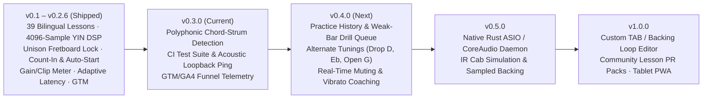

# FretMaster Studio Roadmap

> **Current Production Baseline:** `v0.3.0` (`https://fretmaster-studio.vercel.app`)  
> FretMaster Studio evolves transparently in lockstep with open GitHub Milestones and Issues (`#1`–`#6`).

---

## Shipped Foundation (`v0.1.0` – `v0.2.6`)

- **Bilingual 39-Lesson Curriculum**: 4 Phases, 9 Modules, and 39 structured lessons in English and Korean covering foundational mechanics, 5-layer fretboard harmony, genre accompaniment, iconic solos, blind ear copy, and improvisation.
- **Real Electric Guitar YIN DSP Engine**: `4096`-sample AudioWorklet ring buffer (`65–1450 Hz`), DC removal, `~1400 Hz` low-pass pre-filtering, `2*tau` subharmonic octave-error protection, 5-frame temporal median smoothing, post-onset settling carryover, and context-aware unison position locking on the fretboard (`resolveFretPositionForContext`).
- **Practice & Calibration Studio**: Hybrid wall-clock fallback for stalled `AudioContext` clocks, exam pre-roll count-in & guitar auto-start, real-time Peak dBFS / `CLIP` metering with software trim, 60fps visual 6-tap latency calibration, progressive per-bar latency refinement, Supabase Google OAuth sync, and Google Tag (`GTM-5PHL3X34`).

---

## `v0.3.0` — Polyphonic Chord Verification, Automated DSP CI & Funnel Telemetry

*Status: Current Release* · Linked Issues: [#2](https://github.com/srain0626/fretmaster-studio/issues/2), [#4](https://github.com/srain0626/fretmaster-studio/issues/4)

- **Polyphonic Chord-Strum Detection (`#4`)**:
  - `8192`-point zero-padded Hann-windowed FFT inside `guitarPitchWorklet.js` computing 45-bin guitar pitch-energy spectrum (`E2 MIDI 40` to `C6 MIDI 84`) and 12-bin chromagram alongside YIN.
  - `evaluatePolyphonicChord()` verifies simultaneous chord-tone energy for Power Chords (`1+5+8`) and Major/Minor Triads, guards against Major vs. Minor 3rd confusion, flags unmuted low open-string ring (`unmutedStringWarning`), and lights up active resonances directly on the fretboard.
- **Permanent Unit Test Suite, CI & 1-Click Acoustic Loopback Ping (`#2`)**:
  - Node built-in test runner suite (`npm test`) covering `tests/dsp.test.mjs`, `tests/polyphonic.test.mjs`, and `tests/transport.test.mjs`, plus `npm run check:emojis` and `.github/workflows/ci.yml`.
  - Dual-mode latency calibrator adding **1-Click Acoustic Loopback Ping** (`1800 Hz` 12ms pulse detection) alongside the 60fps Visual 6-Tap Runway.
- **Privacy-Safe Learning Funnel Analytics**:
  - Non-PII `dataLayer` events (`onboarding_completed`, `audio_connected`, `latency_calibrated`, `lesson_selected`, `practice_mode_started`, `exam_completed`, `earcopy_completed`) to inform difficulty balancing and onboarding UX.

---

## `v0.4.0` — Practice Analytics, Alternate Tunings & Fine Technique Coaching

*Linked Issues:* [#3](https://github.com/srain0626/fretmaster-studio/issues/3), [#5](https://github.com/srain0626/fretmaster-studio/issues/5)

- **Practice History Charts & Adaptive Weak-Bar Drill Queue (`#5`)**:
  - Visualize daily practice minutes, accuracy trend, BPM velocity, and early/late timing bias from Supabase `practice_sessions`.
  - Automatically assemble a daily 5-minute warm-up drill queue targeting persistent `weakBarIndices` at `80%` tempo with automatic `+5 BPM` progression.
- **Alternate Tunings & Capo Support (`#3`)**:
  - Generalize `STANDARD_TUNING_MIDI` into selectable tuning profiles (`Drop D`, `Eb Standard`, `Open G`, `DADGAD`) propagating seamlessly across the tuner, fretboard unison resolver, Web Audio synth, and dedicated riffs.
- **Real-Time String Muting & Vibrato Contour Feedback**:
  - Detect overlapping unmuted open-string sustain during single-note exercises (`1-1` through `2-4`) and render live vibrato pitch width/rate feedback.

---

## `v0.5.0` — Native ASIO/CoreAudio Bridge Daemon & Studio Monitoring

*Linked Issue:* [#1](https://github.com/srain0626/fretmaster-studio/issues/1)

- **Cross-Platform Native WebSocket Bridge (`ws://127.0.0.1:9420`, `#1`)**:
  - Lightweight open-source Rust (`cpal` + `tokio-tungstenite`) tray utility for Windows ASIO, macOS CoreAudio, and Linux JACK hardware audio interfaces at `2–4 ms` round-trip latency.
  - Seamless 1-click pairing with the existing `asio-bridge` client pipeline in `lowLatencyAudioEngine.ts`.
- **Optional Cabinet IR Tone Monitoring & Sampled Drum/Bass Backing**:
  - Web Audio convolution cabinet simulation (`Clean`, `Crunch`, `Lead`) and sampled multi-genre backing grooves for headphone practice without an external amp.

---

## `v1.0.0` — Custom TAB Authoring, Community Lesson Packs & Mobile/PWA

*Linked Issue:* [#6](https://github.com/srain0626/fretmaster-studio/issues/6)

- **Custom TAB & Backing Loop Editor (`#6`)**:
  - Author custom chord progressions, custom riffs, and loop drills via fretboard click or real-guitar recording with JSON / MusicXML import-export.
  - Schema-validated Community Lesson Pack PR workflow so teachers and guitarists can contribute bilingual modules.
- **Landscape Tablet Studio & Offline PWA**:
  - Dedicated landscape viewport optimization for iPad/Android tablets with USB-C audio interfaces and offline-first caching with automatic Supabase sync upon reconnection.
