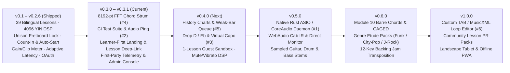

# FretMaster Studio Roadmap

> **Current Production Baseline:** `v0.3.1` (`https://fretmaster-studio.vercel.app`)  
> FretMaster Studio evolves transparently in lockstep with open GitHub Milestones and Issues (`#1`–`#6`), linking real learner funnel insights directly to upcoming pedagogy, sound, and creator milestones.

---

## Shipped Foundation (`v0.1.0` – `v0.2.6`)

- **Bilingual 39-Lesson Curriculum**: 4 Phases, 9 Modules, and 39 structured lessons in English and Korean covering foundational mechanics, 5-layer fretboard harmony, genre accompaniment, iconic solos, blind ear copy, and improvisation.
- **Real Electric Guitar YIN DSP Engine**: `4096`-sample AudioWorklet ring buffer (`65–1450 Hz`), DC removal, `~1400 Hz` low-pass pre-filtering, `2*tau` subharmonic octave-error protection, 5-frame temporal median smoothing, post-onset settling carryover, and context-aware unison position locking on the fretboard (`resolveFretPositionForContext`).
- **Practice, Onboarding & Cloud Studio**: Hybrid wall-clock fallback for stalled `AudioContext` clocks, exam pre-roll count-in & guitar auto-start, real-time Peak dBFS / `CLIP` metering with software trim, 60fps visual 6-tap latency calibration, progressive per-bar latency refinement, 4-step first-login onboarding tutorial, sanitized diagnostic reporting, and Supabase Google OAuth progress sync.

---

## `v0.3.0` – `v0.3.1` — Polyphonic Chord Verification, CI Quality, Conversion UX & Funnel Telemetry

*Status: Current Production Baseline* · Linked Issues: [#2](https://github.com/srain0626/fretmaster-studio/issues/2), [#4](https://github.com/srain0626/fretmaster-studio/issues/4)

- **Polyphonic Chord-Strum Detection (`#4`)**:
  - `8192`-point zero-padded Hann-windowed FFT inside `guitarPitchWorklet.js` computing a 45-bin guitar pitch-energy spectrum (`E2 MIDI 40` to `C6 MIDI 84`) and 12-bin chromagram alongside YIN.
  - `evaluatePolyphonicChord()` verifies simultaneous chord-tone energy for Power Chords (`1+5+8`) and Major/Minor Triads, guards against Major vs. Minor 3rd confusion, flags unmuted low open-string ring (`unmutedStringWarning`), and lights up active resonances on the fretboard.
- **Permanent Unit Test Suite, CI & 1-Click Acoustic Loopback Ping (`#2`)**:
  - Node built-in test runner suite (`npm test`) covering `tests/dsp.test.mjs`, `tests/polyphonic.test.mjs`, `tests/transport.test.mjs`, and `tests/admin.test.mjs`, plus `npm run check:emojis` and `.github/workflows/ci.yml`.
  - Dual-mode latency calibrator adding **1-Click Acoustic Loopback Ping** (`1800 Hz` 12ms pulse detection) alongside the 60fps Visual 6-Tap Runway.
- **Learner-First Landing Experience & Direct Lesson Deep-Linking (`v0.3.1`)**:
  - Rebuilt `/` around learner pain points, audible fretboard harmony previews, live chord/mute/bend coaching demos, and 1-click lesson launch (`?lesson=<id>`) preserved seamlessly across Google OAuth sign-in.
  - Initial PWA Web App Manifest (`src/app/manifest.ts`) and streamlined bilingual SEO metadata.
  - **Exam-Free Lesson `1-1` Open-String Warm-Up (`v0.3.1`)**: Added `skipExam: true` progression on Lesson `1-1` (`m1-1`) so beginners advance naturally to Lesson `1-2` without getting blocked by open-string resonance in a passing exam.
- **First-Party Learning Telemetry & Admin Analytics Console (`v0.3.1`)**:
  - Privacy-safe `public.analytics_events` ingestion (`/api/telemetry`) paired with GTM `dataLayer` funnel tracking and a protected `/admin` table analytics dashboard (`is_admin_user()` RBAC) to guide lesson difficulty balancing and retention improvements.

---

## `v0.4.0` — Adaptive Retention Loop, Guest Sandbox, Tunings & Fine Technique Coaching

*Status: Next Up* · Linked Issues: [#3](https://github.com/srain0626/fretmaster-studio/issues/3), [#5](https://github.com/srain0626/fretmaster-studio/issues/5)

- **Practice History Charts, Spaced Review & Weak-Bar Drill Queue (`#5`)**:
  - Upgrade `SkillAnalyticsDialog` with multi-week charts from `practice_sessions` showing daily practice minutes, accuracy trend, BPM velocity, and early/late timing bias.
  - Automatically assemble a daily 5-minute warm-up drill queue targeting persistent `weakBarIndices` at `80%` tempo with `+5 BPM` auto-ramp, plus spaced-repetition review badges on older cleared lessons.
- **Frictionless 1-Lesson Guest Sandbox Mode**:
  - Allow first-time visitors to play curated starter lessons (`1-1` Open Strings, `3-1` Power Chords, `4-1` Pentatonic Box) immediately in-browser before prompting Google sign-in to save progress to the cloud.
- **Alternate Tunings & Virtual Capo Support (`#3`)**:
  - Generalize `STANDARD_TUNING_MIDI` into selectable tuning profiles (`Drop D`, `Eb Standard`, `Open G`, `DADGAD`) and virtual Capo (`0–7F`) propagating across the chromatic tuner, fretboard unison resolver, Web Audio synth, and polyphonic chord evaluator.
- **Single-Note String Muting & Live Vibrato Contour Coaching**:
  - Extend open-string bleed detection to single-note exercises (`1-1` through `2-4`) and render live vibrato pitch-width (`cents`) and rate (`Hz`) wave contour feedback in `6-4`, `8-3`, and `8-4`.

---

## `v0.5.0` — Studio Amp/IR Monitoring, Sampled Backing & Native ASIO/CoreAudio Bridge

*Linked Issue:* [#1](https://github.com/srain0626/fretmaster-studio/issues/1)

- **Cross-Platform Native WebSocket Bridge (`ws://127.0.0.1:9420`, `#1`)**:
  - Lightweight open-source Rust (`cpal` + `tokio-tungstenite`) tray daemon for Windows ASIO, macOS CoreAudio, and Linux JACK hardware audio interfaces at `2–4 ms` round-trip latency, pairing in 1 click with `lowLatencyAudioEngine.ts`.
- **Web Audio Cabinet IR Monitoring & Headphone Pedalboard**:
  - Convolution cabinet IR simulation (`Clean`, `Crunch`, `Lead`), room reverb/delay, and zero-amp headphone `directMonitor` routing for players plugged straight into an audio interface.
- **Velocity-Layered Sampled Guitar, Drum & Bass Stems**:
  - Upgrade synthesized backing tracks with multi-velocity sampled electric guitar, acoustic drum kits, and fingered bass grooves.

---

## `v0.6.0` — Intermediate Curriculum Expansion: Barre Chords, CAGED & Genre Etude Packs

- **Module 10 · Barre Chord Survival & CAGED Neck Connectors**:
  - Dedicated biomechanical posture animations (index-finger lateral roll & thumb leverage) and polyphonic string-clarity verification for E-shape (`F`, `Bm`) and A-shape barre chords—bridging the biggest gap between beginner power chords and full song playing.
- **Contemporary Genre & Extended Technique Packs**:
  - Bilingual lesson modules covering Funk & City-Pop 16th-note rhythm cutting (`maj7`, `m9`, `13`), J-Rock / K-Indie octave drive riffs, and introductory sweep picking & two-hand tapping etudes.
- **12-Key Backing Jam Transposition**:
  - Instant 12-key transposition for chord progressions and scale overlays inside Phase IV Jam Studio.

---

## `v1.0.0` — Creator TAB Studio, Community Lesson Packs & Landscape Tablet PWA

*Linked Issue:* [#6](https://github.com/srain0626/fretmaster-studio/issues/6)

- **Custom TAB / Backing Loop Editor & MusicXML Import (`#6`)**:
  - Author custom chord progressions, riffs, and loop drills via fretboard click or real-guitar capture with JSON and MusicXML import/export.
  - Schema-validated Community Lesson Pack PR workflow (`validate:lesson` CLI) empowering guitar teachers and contributors to publish bilingual modules.
- **Landscape Tablet Studio & Offline-First PWA**:
  - Touch-ergonomic landscape viewport tailored for iPad and Android tablets using USB-C audio interfaces, complete with service-worker offline caching and automatic cloud sync upon reconnection.
